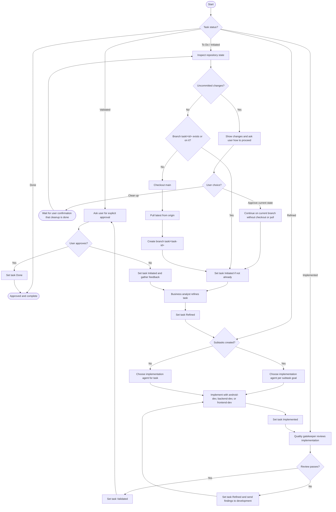

# Coordination Task Workflow

This overview explains what happens when `coordination-task` is used. The `SKILL.md` contains the instructions followed by the coordinating agent; this page is a user-facing guide.

## Resume / restart

Task state lives in the backlog (task status) and the repository (branch). If a run is interrupted, re-invoking the skill must not restart from scratch or lose progress:

- Read the current task status first (`backlog task <id> --plain`); resume from the step matching that status.
- Do not recreate a branch or discard changes if already on `task/<task-id>` or if the branch exists; preserve existing changes.
- Each step is idempotent: check status before acting and skip phases already completed.

## What is done
1. **Resolve target task.** If no task id/path is provided, get the next task from the backlog with `backlog task list --ready --plain` (dependency-ready tasks in default order). Take the first result; ask the user if empty or ambiguous.
2. **Prepare the repository.** Skip this step entirely on resume (status already `Initiated` or later). Otherwise inspect the working tree. If already on branch `task/<task-id>` or that branch exists, reuse it and do not recreate it. If there are uncommitted changes, show them to the user and ask whether they want to clean up or approve continuing in the current repository state. Never commit, stash, or discard those changes. If the user chooses cleanup, wait for confirmation and re-check the working tree; when clean, checkout `main`, pull from `origin`, and create a task-specific branch (only if it does not already exist). If the user approves the current state, preserve the changes and continue on the current branch. In this case, do not checkout `main`, pull from `origin`, or create a branch. Set the task to `Initiated` after repository preparation (if not already).
3. **Refine the task.** The business analyst clarifies scope and may split the task into implementation subtasks. Skip this phase if the status is already `Refined` or later. After refinement, set the task to `Refined`.
4. **Implement.** Delegate each implementation unit to the appropriate development agent (`android-dev`, `backend-dev`, or `frontend-dev`). Independent units may proceed in parallel. Skip this phase if the status is already `Implemented` or later. Once implementation is complete, set the task to `Implemented`.
5. **Review.** The quality gatekeeper reviews it against the refined task's acceptance criteria and definition of done. An incomplete review returns the task to `Refined` while development resumes. Skip this phase if the status is already `Validated` or later.
6. **Validate and request approval.** A passing review moves the task to `Validated`; present the review result and ask the user for explicit approval.
7. **Complete or revise.** If the user approves, set the task to `Done`. If the user requests changes, return the task to `Initiated`. Depending on the feedback the refinement can be skipped or not, then resume development, and repeat review and validation. An incomplete review returns the task to `Refined` as described above.

Task reads and status changes use the `backlog-md` skill and backlog CLI.