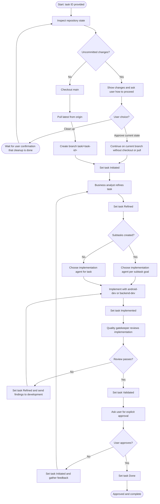

# Coordination Task Workflow

This overview explains what happens when `coordination-task` is used. The `SKILL.md` contains the instructions followed by the coordinating agent; this page is a user-facing guide.

## What is done
1. **Prepare the repository.** Inspect the working tree. If there are uncommitted changes, show them to the user and ask whether they want to clean up or approve continuing in the current repository state. Never commit, stash, or discard those changes. If the user chooses cleanup, wait for confirmation and re-check the working tree; when clean, checkout `main`, pull from `origin`, and create a task-specific branch. If the user approves the current state, preserve the changes and continue on the current branch. In this case, do not checkout `main`, pull from `origin`, or create a branch. Set the task to `Initiated` after repository preparation.
2. **Refine the task.** The business analyst clarifies scope and may split the task into implementation subtasks. After refinement, set the task to `Refined`.
3. **Implement.** Delegate each implementation unit to the appropriate development agent. Independent units may proceed in parallel. Once implementation is complete, set the task to `Implemented`.
4. **Review.** The quality gatekeeper reviews it against the refined task's acceptance criteria and definition of done. An incomplete review returns the task to `Refined` while development resumes.
5. **Validate and request approval.** A passing review moves the task to `Validated`; present the review result and ask the user for explicit approval.
6. **Complete or revise.** If the user approves, set the task to `Done`. If the user requests changes, return the task to `Initiated`. Depending on the feedback the refinement can be skipped or not, then resume development, and repeat review and validation. An incomplete review returns the task to `Refined` as described above.

Task reads and status changes use the `backlog-md` skill and backlog CLI.
