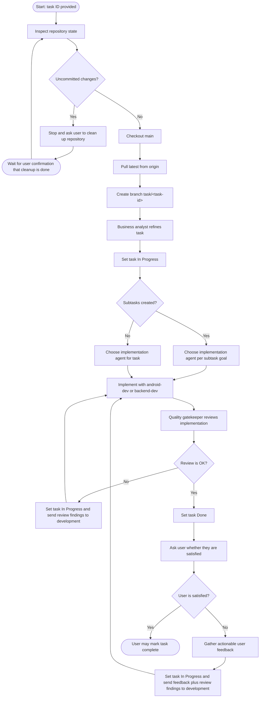

# Coordination Task Workflow

This overview explains what happens when `coordination-task` is used. The `SKILL.md` contains the instructions followed by the coordinating agent; this page is a user-facing guide.

## What to expect

1. The working tree is checked first. If it has uncommitted changes, coordination stops and the user is asked to clean up the repository and confirm when done; those changes are not committed, stashed, or discarded by the skill. After the user's confirmation, the working tree is checked again. Once clean, the repository is prepared on a task-specific branch before refinement or implementation.
2. The business analyst clarifies the task and may split it into implementation subtasks.
3. The task is moved to `In Progress`; implementation is delegated per task/subtask to the appropriate development agent. Independent subtasks may proceed in parallel.
4. The quality gatekeeper checks the result against the refined task's acceptance criteria and definition of done.
5. An incomplete review returns the task to `In Progress` and its findings go to development. An OK review sets the task to `Done`, after which the user is explicitly asked whether they are satisfied. If not, actionable feedback is gathered before the task returns to `In Progress` and development resumes with both that feedback and the review findings. The user decides when to mark it complete.

Task reads and status changes use the `backlog-md` skill and backlog CLI.
