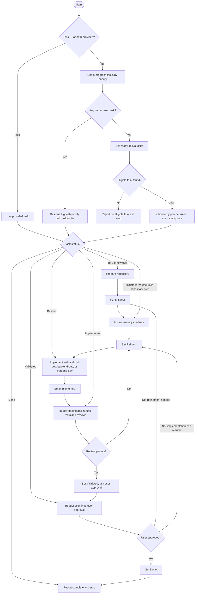

# Coordination Task Workflow

This overview explains the workflow implemented by `SKILL.md`. Backlog task reads and status changes use the Backlog.md CLI; agent delegation uses OpenCode's `subagent` tool.

## Resume and task selection

- If a task ID/path is supplied, coordinate that task.
- Otherwise, first run `backlog task list --status "Initiated,Refined,Implemented,Validated" --sort priority --plain`. Resume the highest-priority in-progress task; ask the user if the highest priority is tied.
- If no task is in progress, run `backlog task list --status "To Do" --ready --plain` and choose using the project-planner prioritization rules. Ask if the choice remains ambiguous.
- On resume, read the selected task status and skip completed phases. **Repository preparation is only for a new `To Do` task; never run it when resuming `Initiated` or later.**

## Workflow steps

1. **Resolve task.** Follow the selection rules above. `backlog task` is the Backlog.md CLI command for task operations; it does not launch agents.
2. **Prepare repository (new tasks only).** For `To Do`, inspect the working tree and follow `SKILL.md` safeguards. For any resumed status (`Initiated` or later), skip repository preparation entirely and preserve the current branch and changes.
3. **Refine.** Delegate to `business-analyst`; set status to `Refined` when complete. Skip if already `Refined` or later.
4. **Implement.** Delegate units to `android-dev`, `backend-dev`, or `frontend-dev`. Capture each agent's evidence response; set status to `Implemented` when complete.
5. **Review.** Delegate to `quality-gatekeeper` using OpenCode's `subagent` tool. It independently reruns relevant tests and verifies the ticket. If incomplete, set status to `Refined`, address findings, and review again.
6. **Approve.** A passing review sets status to `Validated`; ask the user. Set status to `Done` only after explicit approval. If changes are requested, use `Initiated` if refinement is needed, otherwise `Refined` to resume implementation without repository preparation.

All backlog reads and writes use the Backlog.md CLI via the `backlog-md` skill. Subagent launches use OpenCode's `subagent` tool, not the Backlog CLI's `task` command.
