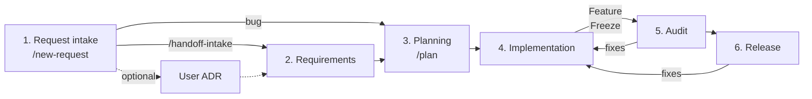

## End-to-End

### Workflow

### Phases

| Phase             | Definition                                                                                                                                                                                                                                                                                                                                                                                                                                                                                                                                                                                                                                                               | Actor responsible                                                              | Output artifact                                                                                                                                                                   |
| ----------------- | ------------------------------------------------------------------------------------------------------------------------------------------------------------------------------------------------------------------------------------------------------------------------------------------------------------------------------------------------------------------------------------------------------------------------------------------------------------------------------------------------------------------------------------------------------------------------------------------------------------------------------------------------------------------------ | ------------------------------------------------------------------------------ | --------------------------------------------------------------------------------------------------------------------------------------------------------------------------------- |
| 1. Request intake | Capture incoming requests (`enhancement`, `technical-improvement`, or `bug`) as a summary in canonical business terminology, check them against existing project records, collect obvious gaps as broad clarification questions, and group them. Agree with the requester whether the request is `open` or `parked`, then create the request artifact. Started by the orchestrator with `/new-request`.                                                                                                                                                                                                                                                                       | `orchestrator`                                                                 | Requests                                                                                                                                                                          |
| 2. Requirements   | Elicit, document, and verify business and non-functional requirements traceable to the request and its open questions. Check that the new request does not contradict an existing requirement, and resolve any conflict with the user. Assess the impact on business rules, glossary, and domain model, and delegate each to its owner. No technical assessment and no architecture work. The user may create an ADR between Phases 1 and 2 to fix a business or technical choice and document its trade-off.  A `bug` request bypasses this phase and goes directly to planning.                                                                                            | `requirements-engineer`                                                        | Requirements; Business Rules, Business Glossary, Domain Model when impacted; Decision (ADRs authored by the user between Phases 1 and 2)                                            |
| 3. Planning       | Create the milestone and its main tasks for one request with `/plan REQUEST-xxx`, or for every open request when no request is given. Each enhancement and each technical improvement gets its own milestone; `bug` tasks are packed into one milestone per planning batch. A milestone is composed of one refinement task, one or more development tasks, and one verification task. Write the milestone acceptance criteria, set releases, dependencies, and ordinals. Involve the user for priority. Close the planned requests, reject the ones that will not be implemented.                                                                                                | `orchestrator`                                                                 | Backlog; Task; Milestone; Release                                                                                                                                                 |
| 4. Implementation | Execute the planned milestone tasks. Refinement analyses the architecture impact and produces the technical specification, the technical decisions, the UI design and mockups when needed, the Gherkin test cases, and the development tasks with precise acceptance criteria. Development implements the tasks and fulfils their acceptance criteria. The `quality-gatekeeper` verifies that every milestone acceptance criterion is fulfilled, applies the basic code quality gates, and creates correction tasks when needed. Phases 1 to 4 repeat until the user declares a feature freeze.                                                                                  | `task-refiner`, `*-dev` agents, `quality-gatekeeper`, `orchestrator`            | Technical specification; Decision; UI Specification; UI Mockups; Test Case; Source Code; milestone verification result                                                              |
| 5. Audit          | Run once at the feature freeze, over the whole frozen codebase. Each audit is a skill with its own output artifact, run by the orchestrator: security audit (`security-audit` skill), quality audit (`quality-audit` skill), code audit (`code-audit` skill). Report every finding to the user, who decides to fix it or own it. Fixed findings become a fix milestone and its tasks, executed in Phase 4; owned findings are documented with an owner. It does not version, package, deploy, or release.                                                                                                                                                                    | `orchestrator`                                                                 | Audit (types `quality`, `code`, `security`)                                                                                                                                       |
| 6. Release        | Start only from a passed audit. Obtain the user's approval of the release scope and the audit findings, choose the final version from the included changes, run the final build and tests, have the `*-dev` agents build the final release packages, assemble the release report, request release approval, deploy the packages through the `ops` agent, and record completion. Failures become a fix milestone, implemented in Phase 4 and audited again in Phase 5.                                                                                                                                                                                                            | `orchestrator`, `*-dev` agents, `ops`                                          | Release report; final package under `builds/<version>/`; deployment evidence; Release completed                                                                                   |

### Flow rules

- Request intake, requirements, planning, and implementation repeat for every round of requests. The loop does not end by itself.
- A **feature freeze** is a user decision. It closes the loop: no new requests, requirements, scope, or features enter the work; only fixes to findings are allowed. The audit then starts, and the release is published when the audit passes and the user approves it.
- A milestone is one refinement task, one or more development tasks, and one verification task. It is complete when its verification task passes.
- The milestone verification checks the milestone acceptance criteria and the basic code quality gates. No RC version and no RC package are produced per milestone.
- Audit runs once over the whole codebase at the freeze, not per milestone. It audits quality, code, and security, each through its skill and artifact.
- Final packages are built in Release by the `*-dev` agents under the final version, and deployed by the `ops` agent.
