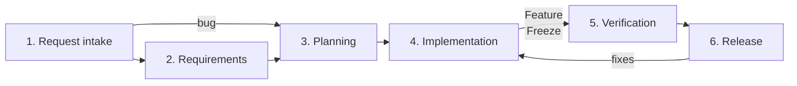

## End-to-End

### Workflow

### Phases

| Phase             | Definition                                                                                                                                                                                                                                                                                                                                                                                                                                                                                                                                                                               | Actor responsible                                                                                                                                   | Output artifact                                                                                                                                                   |
| ----------------- | ---------------------------------------------------------------------------------------------------------------------------------------------------------------------------------------------------------------------------------------------------------------------------------------------------------------------------------------------------------------------------------------------------------------------------------------------------------------------------------------------------------------------------------------------------------------------------------------- | --------------------------------------------------------------------------------------------------------------------------------------------------- | ----------------------------------------------------------------------------------------------------------------------------------------------------------------- |
| 1. Request intake | Capture incoming requests (`enhancement`, `technical-improvement`, or `bug`) as a summary in canonical business terminology, check them against existing project records, collect obvious gaps as broad clarification questions, and group them. Agree with the requester whether the request is `open` or `parked`, then create the request artifact.                                                                                                                                                                                                                                   | `key-account-manager`                                                                                                                               | Requests                                                                                                                                                          |
| 2. Requirements   | Elicit, document, and verify business and non-functional requirements traceable to the request and its open questions. Assess the impact on business rules, glossary, domain model, and decisions; delegate each to its owner.  A `bug` request bypasses this phase and goes directly to planning.                                                                                                                                                                                                                                                                                   | `requirements-engineer`                                                                                                                             | Requirements; Business Rules, Business Glossary, Domain Model, Decision (type `business`) when impacted                                                           |
| 3. Planning       | Decide the tasks needed, attribute each to the actor able to fulfill it, and set milestones, releases, dependencies, and ordinals. Each enhancement and each technical improvement gets its own milestone; `bug` tasks are packed into one milestone per planning batch. Write the milestone acceptance criteria and its tasks, ending with the milestone verification and build tasks. Involve the user for priority. Close the planned requests, rejected the ones that will not be implemented.                                                                                       | `planner`                                                                                                                                           | Backlog; Task; Milestone; Release                                                                                                                                 |
| 4. Implementation | Execute the planned tasks: architecture impact assessment, UI design, test design, refinement, and implementation. Update the Architecture, Decisions, Technical specification, UI Specification, UI Mockups, Test Cases, and Source Code as the work requires. At the end of each successfully implemented milestone, create its RC version and build a package for every element of the system (e.g. Android app, server) under that single shared version. Intake, requirements, planning, and implementation repeat for each request round until the user declares a feature freeze. | `architect`, `ui-designer`, `task-refiner`, `test-manager`, `tech-writer`, `android-dev`, `backend-dev`, `frontend-dev`, `rust-dev`, `orchestrator` | Architecture; Decision (type `architecture`); Technical specification; UI Specification; UI Mockups; Test Case; Source Code; RC package under `builds/<version>/` |
| 5. Verification   | Run once at the feature freeze, over the whole codebase. Contains:  - quality audit (is every feature implemented properly, against its requirements and acceptance criteria) - code audit (is the code maintainable and evolvable, does it follow the code guidelines) - security audit (can the software be exploited).  Findings become fix tasks; the audits rerun until all of them pass. Verification records the audits and one release verification task. It does not version, package, or release.                                                              | `quality-gatekeeper`, `code-analyzer`, `security-officer`, `orchestrator`, `planner`                                                                | Audit (types `quality`, `code`, `security`); release verification task                                                                                            |
| 6. Release        | Start only from a passed verification. Obtain the user's approval of the release scope and the audit findings, choose the final version from the included changes and the milestone RC versions, run the final build and tests, publish the final-version package locally, assemble the release report, request release approval, and record completion. Failures become fix tasks in a fix milestone, implemented in Phase 4 and verified again in Phase 5.                                                                                                                             | `orchestrator`, `quality-gatekeeper`, `planner`                                                                                                     | Release report; final package under `builds/<version>/`; Release completed                                                                                        |

### Flow rules

- Request intake, requirements, planning, and implementation repeat for every round of requests. The loop does not end by itself.
- A **feature freeze** is a user decision. It closes the loop: no new requests, requirements, scope, or features enter the work; only fixes to findings are allowed. Verification then starts, and the release is published when verification succeeds.
- A milestone ends with its RC build: one RC version for the whole system and one package per system element, all under that same version. Each element (Android app, server, and so on) is built at the end of the milestone.
- Verification runs once over the whole codebase at the freeze, not per milestone. It audits quality, code, and security.
- Milestone RC packages are candidates. The final package is built and published in Release under the final version.
