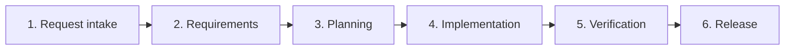

## End-to-End

### Workflow

### Phases

| Phase             | Definition                                                                                                                                                                                                                                                                                                                                                                                                                          | Actor responsible                                                                                                                   | Output artifact                                                                                                             |
| ----------------- | ----------------------------------------------------------------------------------------------------------------------------------------------------------------------------------------------------------------------------------------------------------------------------------------------------------------------------------------------------------------------------------------------------------------------------------- | ----------------------------------------------------------------------------------------------------------------------------------- | --------------------------------------------------------------------------------------------------------------------------- |
| 1. Request intake | Capture incoming requests (`enhancement`, `techincal-improvement`, or `bug`) as a summary in canonical business terminology, check them against existing project records, collect obvious gaps as broad clarification questions, and group them. Agree with the requester whether the request is `open` or `parked`, then create the request artifact. It is the only intake path and the handoff to Phase 2.                       | `key-account-manager`                                                                                                               | Requests                                                                                                                    |
| 2. Requirements   | Elicit, document, and verify business and non-functional requirements traceable to the request and its open questions. Assess the impact on business rules, glossary, domain model, and decisions; delegate each to its owner. A `bug` request bypasses this phase and goes directly to planning.                                                                                                                                   | `requirements-engineer`                                                                                                             | Requirements; Business Rules, Business Glossary, Domain Model, Decision (type `business`) when impacted                     |
| 3. Planning       | Decide the tasks needed, attribute each to the actor able to fulfil it, and set milestones, releases, dependencies, and ordinals. Each enhancement and each technical improvement gets its own milestone; `bug` tasks are packed into one milestone per batch. Write the milestone acceptance criteria and one milestone verification task. Involve the user for priority. Close or reject the planned requests.                    | `planner`                                                                                                                           | Backlog; Task; Milestone; Release                                                                                           |
| 4. Implementation | Execute the planned tasks: architecture impact assessment, UI design, test design, refinement, and implementation. Update the Architecture, Decisions, Technical specification, UI Specification, UI Mockups, Test Cases, and Source Code as the work requires.                                                                                                                                                                     | `architect`, `ui-designer`, `task-refiner`, `test-manager`, `tech-writer`, `android-dev`, `backend-dev`, `frontend-dev`, `rust-dev` | Architecture; Decision (type `architecture`); Technical specification; UI Specification; UI Mockups; Test Case; Source Code |
| 5. Verification   | Independently verify a milestone at its boundary against its acceptance criteria, quality requirements, and code quality, through the quality review and the code audit. Determine the RC version of the verified milestone. Security is not assessed here.                                                                                                                                                                         | `quality-gatekeeper`, `code-analyzer`, `orchestrator`                                                                               | Milestone verification task; Audit (types `quality`, `code`)                                                                |
| 6. Release        | Inspect the whole release: confirm every milestone is complete and verified, run the release quality, code, and security audits, and obtain the user's approval of scope and findings. Choose the final version from all included changes and the milestone RC versions, run the final build and tests, assemble the release report, request release approval, and record completion. Failures become fix tasks in a fix milestone. | `orchestrator`, `quality-gatekeeper`, `code-analyzer`, `security-officer`, `planner`                                                | Audit (quality, code, security); Release report; Release completed                                                          |
