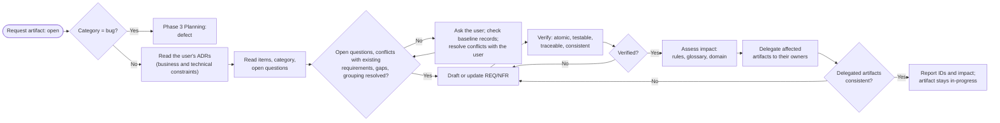

## 2. Requirements

Phase 2 turns an open request artifact, except `bug` requests, into **verified, traceable business and non-functional requirements**, and settles the impact on business rules, glossary, and domain model. It states what the software shall do and how well; it does not decide how it will be built or when.

Phase position: `Phase 1 → Phase 2 → Phase 3 Planning`. Output artifacts are defined in [artifacts.md](./artifacts.md).

### Input and trigger

- **Input:** one request artifact with status `open` and category `enhancement` or `technical-improvement` (see [1-Request_intake](./1-Request_intake.md)). `bug` requests bypass this phase.
- **Input:** any Decision record (ADR) the user created between Phases 1 and 2. It fixes a business or technical choice, documents its trade-off, and is a constraint on the requirements.
- **Trigger:** `/handoff-intake` hands the request artifact to `requirements-engineer`.
- **Scope:** the artifact's items, category, open questions, requested outcome, and the user's ADRs. Nothing outside it is added.
- `requirements-engineer` marks the artifact `in-progress` as soon as it starts working on it. It stays `in-progress` in this phase; Phase 3 sets it `closed` once the work is planned, or `rejected` with a reason.

An incomplete or missing request artifact is not worked around: it returns to Phase 1.

### Actors

| Actor                   | Role in Phase 2                                                                                                |
| ----------------------- | -------------------------------------------------------------------------------------------------------------- |
| `requirements-engineer` | Owner: elicits, writes, and validates business and non-functional requirements; checks conflicts; assesses impact and delegates |
| `business-analyst`      | Updates business rules when decision logic or constraints are affected                                         |
| `terminologist`         | Updates the glossary when domain language is new or changed                                                    |
| `domain-modeler`        | Updates the domain model when concepts, states, attributes, or processes are affected                         |
| `orchestrator`          | Hands the request over with `/handoff-intake` and collects the result; never edits requirements               |
| Requester / user        | Owns product decisions, creates ADRs between Phases 1 and 2, and resolves conflicts with existing requirements |

`requirements-engineer` is the sole editor of business and non-functional requirements. A requirement change requested elsewhere is routed back to it. When a served requirement changes, its business rules return to `draft` until re-verified.

No architecture role participates in this phase. Phase 2 performs no technical assessment and produces no architecture, specification, UI, or test design.

### Flow

### Requirement content

**Business requirement (atomic):** identifier, title, group, user story, description, acceptance criteria, and references to the request artifact and related requirements. One behavior per requirement; acceptance criteria are testable and unambiguous.

**Requirement group:** identifier, title, scope description, and user story.

**Non-functional requirement (atomic):** identifier, group, description with an observable and achievable target, quality attribute or constraint named in the rationale, verification method, and references. If a target cannot be verified, it is not ready.

Requirements contain no solution design, architecture choice, technology, task, or estimate. Identifiers are two-level: `REQ-001` for a group and `REQ-001.002` for an atomic requirement; the same applies to `NFR`.

### Steps

1. **Read** the request artifact and the user's ADRs: items, category, grouping, open questions, and fixed choices.
2. **Resolve open questions** with the requester. A product decision is never inferred; the answer is recorded on the artifact.
3. **Run baseline checks** before drafting: conflicts with existing requirements, definition gaps, overlap, and group placement (see below). A conflict is resolved with the user, never silently superseded.
4. **Elicit** behavior, actors, triggers, data, error cases, and quality attributes for each item, closing the gaps found in step 3.
5. **Draft or update** business and non-functional requirements.
6. **Verify** the draft: atomic, testable, traceable, consistent.
7. **Assess impact** and delegate the artifacts that must change (table below).
8. **Confirm consistency** between requirements and the delegated artifacts; a mismatch returns to drafting.
9. **Trace and report**: link requirements to the request artifact, keep it `in-progress`, and report to the orchestrator.

### Baseline checks

Run before drafting; a failure returns to the requester or to the baseline records, never to an assumption.

| Check               | Question                                                                                                                           | If it fails                                                                                              |
| ------------------- | ---------------------------------------------------------------------------------------------------------------------------------- | -------------------------------------------------------------------------------------------------------- |
| Existing conflict   | Does an existing requirement state a conflicting behavior, target, or constraint?                                                   | Ask the user to resolve the conflict; record which requirement is superseded                             |
| Definition gap      | Are actor, trigger, behavior, data, error cases, quality attributes, and acceptance criteria stated, or explicitly not applicable? | Ask the requester; record the answer on the artifact or in the requirement                               |
| Overlap             | Is the need already covered, fully or partially?                                                                                   | Update the existing requirement instead of creating a duplicate                                          |
| Group placement     | Does an existing requirement group fit the new requirement?                                                                        | Create a new group with title, scope, and user story before its first requirement                        |

Every affected requirement group is named in the phase result, including newly created ones. Conflicting requirements are a user decision: Phase 2 never rewrites an existing requirement by interpretation.

### Impact assessment

| Impact                                                              | Artifact                               | Owner                   | Gate                                                                                                   |
| ------------------------------------------------------------------- | -------------------------------------- | ----------------------- | ------------------------------------------------------------------------------------------------------ |
| New or changed decision logic, formula, or constraint               | Business Rules                         | `business-analyst`      | Open business decisions block                                                                          |
| New or changed domain term                                          | Business Glossary                      | `terminologist`         | The term is defined before use in specs, tasks, or UI                                                |
| New or changed concepts, lifecycle states, attributes, or processes | Domain Model                           | `domain-modeler`        | Conflicts are reported back and resolved with the requester                                            |
| New or changed behavior                                             | Business Requirements                  | `requirements-engineer` | Verified before planning                                                                              |
| Quality target, constraint, integration, or cross-cutting concern   | Requirements (NFR)                     | `requirements-engineer` | Recorded for refinement, which performs the architecture impact analysis in Phase 4                   |
| Trade-off not obvious across stakeholders, in-depth record required | Decision (type: `business` or `architecture`) | `user`          | Created by the user between Phases 1 and 2; requirements depend on it once accepted                    |
| None                                                                | —                                      | —                       | Recorded explicitly as `none`                                                                          |

Rules:

- Assessment is mandatory; the "no impact" outcome is an explicit decision, not a silent skip.
- Delegation is by ownership: no agent edits another owner's artifact, except `status` and `references`.
- Delegated artifacts return to Phase 2 for a consistency check against the requirements before the phase closes.
- Technical assessment, architecture, specification, UI design, and test design are **not** Phase 2 work. A technical constraint enters through a user ADR; architecture impact is analysed in Phase 4 refinement.

### Request categories

| Category                | Requirement treatment                                                                                                                           |
| ----------------------- | ----------------------------------------------------------------------------------------------------------------------------------------------- |
| `bug`                   | Bypasses Phase 2: routed from Phase 1 directly to Phase 3 as a defect. A requirement is created only if the defect exposes unspecified behavior |
| `enhancement`           | New or changed business requirement                                                                                                             |
| `technical-improvement` | NFR when a quality attribute changes; otherwise no requirement change, with the reason recorded                                                 |

### Verification

A phase result is `verified` only when all hold:

- every artifact item is covered by a requirement, or rejected with a reason recorded on the request artifact (the request itself is set `rejected` only in Phase 3);
- the new requirements do not contradict an existing requirement, or the user chose the resolution and the superseded requirement is recorded;
- traceability runs both ways: request artifact → REQ/NFR, and REQ/NFR → affected rules, glossary terms, and domain objects;
- requirements are atomic, testable, and free of solution design;
- NFR targets are observable and achievable, and their verification methods are defined;
- no duplicates remain, and every conflict is resolved with the user;
- each requirement sits in the correct group, and every new group is scoped and has a user story;
- changed meaning was confirmed by the requester;
- terminology is canonical and the glossary is consistent with the requirement wording;
- requirements and delegated artifacts are consistent with each other;
- all records are retrievable and listable in the requirements corpus.

Otherwise the result is `gaps` (fixable defects) or `blocked` (a decision is missing).

### Exit criteria

Phase 2 is complete when:

- requirements are verified, and impacted rules, glossary, domain model, and decisions are settled or explicitly `none`;
- no open product or business decision remains;
- the request artifact references the requirements produced from it and remains `in-progress`; Phase 3 sets it `closed` once planned, or `rejected` with a reason;
- the orchestrator receives: changed and created requirement and group IDs, verification status, open questions, impact outcomes, and the artifact status (`in-progress`).

No planning, task creation, prioritisation, or estimation happens here.

### Boundaries

Phase 2 never:

- performs technical assessment or architecture work;
- decides scope, priority, order, milestones, or releases;
- designs solutions, architecture, interfaces, or UI;
- writes code or tests;
- creates or edits business rules, glossary entries, or domain artifacts directly;
- creates, edits, or supersedes a Decision: ADRs are the user's;
- invents requirements to close a gap, or resolves a conflict by interpretation;
- changes requirement meaning without requester confirmation;
- sets the request artifact to `closed` or `rejected`; that happens in Phase 3.

### Stop conditions

- Unresolved product decision: stop before drafting.
- Request artifact missing, incomplete, or unconfirmed: return to Phase 1.
- Conflicting requirements that only a product decision can settle: stop and ask the user.
- Affected rules or terms contradict the intended behavior: return to the owning step, do not patch requirements by implication.
- Meaning change not confirmed: do not apply it.
