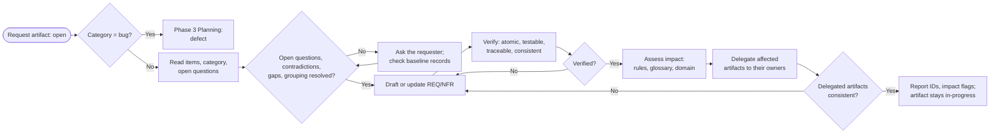

## 2. Requirements

Phase 2 turns an open request artifact, except `bug` requests, into **verified, traceable business and non-functional requirements**, and settles the impact on business rules, glossary, and domain model. It states what the software shall do and how well; it does not decide how it will be built or when.

Phase position: `Phase 1 → Phase 2 → Phase 3 Planning`. Output artifacts are defined in [artifacts.md](./artifacts.md).

### Input and trigger

- **Input:** one request artifact with status `open` and category `enhancement` or `technical-improvement` (see [1-Request_intake](./1-Request_intake.md)). `bug` requests bypass this phase.
- **Trigger:** the orchestrator starts requirement intake for that artifact, or `requirements-engineer` is invoked with its identifier.
- **Scope:** the artifact's items, category, open questions, and requested outcome. Nothing outside it is added.
- `requirements-engineer` marks the artifact `in-progress` as soon as it starts working on it. It stays `in-progress` in this phase; Phase 3 sets it `closed` once the work is planned, or `rejected` with a reason.

An incomplete or missing request artifact is not worked around: it returns to Phase 1.

### Actors

| Actor                   | Role in Phase 2                                                                                               |
| ----------------------- | ------------------------------------------------------------------------------------------------------------- |
| `requirements-engineer` | Owner: elicits, writes, and validates business and non-functional requirements; assesses impact and delegates |
| `business-analyst`      | Updates business rules when decision logic or constraints are affected                                        |
| `terminologist`         | Updates the glossary when domain language is new or changed                                                   |
| `domain-modeler`        | Updates the domain model when concepts, states, attributes, or processes are affected                         |
| `architect`             | Consumes requirements as constraints; owns the architecture and its decisions, not here                       |
| `orchestrator`          | Starts the phase and collects the result; never edits requirements                                            |
| Requester / user        | Owns product decisions; triggers and makes a decision when a trade-off is not obvious across stakeholders      |

`requirements-engineer` is the sole editor of business and non-functional requirements. A requirement change requested elsewhere is routed back to it. When a served requirement changes, its business rules return to `draft` until re-verified.

### Flow

### Requirement content

**Business requirement (atomic):** identifier, title, group, user story, description, acceptance criteria, and references to the request artifact and related requirements. One behavior per requirement; acceptance criteria are testable and unambiguous.

**Requirement group:** identifier, title, scope description, and user story.

**Non-functional requirement (atomic):** identifier, group, description with an observable and achievable target, quality attribute or constraint named in the rationale, verification method, and references. If a target cannot be verified, it is not ready.

Requirements contain no solution design, architecture choice, technology, task, or estimate. Identifiers are two-level: `REQ-001` for a group and `REQ-001.002` for an atomic requirement; the same applies to `NFR`.

### Steps

1. **Read** the request artifact: items, category, grouping, and open questions.
2. **Resolve open questions** with the requester. A product decision is never inferred; the answer is recorded on the artifact.
3. **Run baseline checks** before drafting: contradictions, definition gaps, overlap, and group placement (see below).
4. **Elicit** behavior, actors, triggers, data, error cases, and quality attributes for each item, closing the gaps found in step 3.
5. **Draft or update** business and non-functional requirements.
6. **Verify** the draft: atomic, testable, traceable, consistent.
7. **Assess impact** and delegate the artifacts that must change (table below).
8. **Confirm consistency** between requirements and the delegated artifacts; a mismatch returns to drafting.
9. **Trace and report**: link requirements to the request artifact, keep it `in-progress`, and report to the orchestrator.

### Baseline checks

Run before drafting; a failure returns to the requester or to the baseline records, never to an assumption.

| Check           | Question                                                                                                                           | If it fails                                                                                             |
| --------------- | ---------------------------------------------------------------------------------------------------------------------------------- | ------------------------------------------------------------------------------------------------------- |
| Contradiction   | Does an existing requirement, rule, or specification state a conflicting behavior, target, or constraint?                          | Ask for a product decision. Never silently supersede; record which requirement is replaced |
| Definition gap  | Are actor, trigger, behavior, data, error cases, quality attributes, and acceptance criteria stated, or explicitly not applicable? | Ask the requester; record the answer on the artifact or in the requirement                              |
| Overlap         | Is the need already covered, fully or partially?                                                                                   | Update the existing requirement instead of creating a duplicate                                         |
| Group placement | Does an existing requirement group fit the new requirement?                                                                        | Create a new group with title, scope, and user story before its first requirement                       |

Every affected requirement group is named in the phase result, including newly created ones.

### Impact assessment

| Impact                                                              | Artifact                               | Owner                   | Gate                                                                                                   |
| ------------------------------------------------------------------- | -------------------------------------- | ----------------------- | ------------------------------------------------------------------------------------------------------ |
| New or changed decision logic, formula, or constraint               | Business Rules                         | `business-analyst`      | Open business decisions block                                                                          |
| New or changed domain term                                          | Business Glossary                      | `terminologist`         | The term is defined before use in specs, tasks, or UI                                                |
| New or changed concepts, lifecycle states, attributes, or processes | Domain Model                           | `domain-modeler`        | Conflicts are reported back and resolved with the requester                                            |
| New or changed behavior                                             | Business Requirements                  | `requirements-engineer` | Verified before planning                                                                              |
| Quality target, constraint, integration, or cross-cutting concern   | Requirements (NFR)                     | `requirements-engineer` | Flagged for the architecture impact assessment planned in Phase 3                                      |
| Trade-off not obvious across stakeholders, in-depth record required | Decision (type: `business`)            | `user`                  | The user triggers the decision; requirements depend on it once accepted                                |
| Technological change                                                | Architecture (impact flag only)        | `architect`             | The reason for the current situation is recorded and reported as a flag; no architecture or specification work happens in Phase 2 |
| None                                                                | —                                      | —                       | Recorded explicitly as `none`                                                                          |

Rules:

- Assessment is mandatory; the "no impact" outcome is an explicit decision, not a silent skip.
- Delegation is by ownership: no agent edits another owner's artifact, except `status` and `references`.
- Delegated artifacts return to Phase 2 for a consistency check against the requirements before the phase closes.
- Architecture analysis, UI design, and technical specification are **not** Phase 2 work; Phase 2 only reports the impact flags that Phase 3 schedules.

### Request categories

| Category                | Requirement treatment                                                                                                                           |
| ----------------------- | ----------------------------------------------------------------------------------------------------------------------------------------------- |
| `bug`                   | Bypasses Phase 2: routed from Phase 1 directly to Phase 3 as a defect. A requirement is created only if the defect exposes unspecified behavior |
| `enhancement`           | New or changed business requirement                                                                                                             |
| `technical-improvement` | NFR when a quality attribute changes; otherwise no requirement change, with the reason recorded                                                 |

### Verification

A phase result is `verified` only when all hold:

- every artifact item is covered by a requirement, or rejected with a reason recorded on the request artifact (the request itself is set `rejected` only in Phase 3);
- traceability runs both ways: request artifact → REQ/NFR, and REQ/NFR → affected rules, glossary terms, and domain objects;
- requirements are atomic, testable, and free of solution design;
- NFR targets are observable and achievable, and their verification methods are defined;
- no duplicates or contradictions remain, or the conflict is escalated as a decision;
- each requirement sits in the correct group, and every new group is scoped and has a user story;
- changed meaning was confirmed by the requester;
- terminology is canonical and the glossary is consistent with the requirement wording;
- requirements and delegated artifacts are consistent with each other;
- all records are retrievable and listable in the requirements corpus.

Otherwise the result is `gaps` (fixable defects) or `blocked` (a decision is missing).

### Exit criteria

Phase 2 is complete when:

- requirements are verified, and impacted rules, glossary, domain model, and decisions are settled or explicitly `none`;
- no open product or business decision remains;
- the request artifact references the requirements produced from it and remains `in-progress`; Phase 3 sets it `closed` once planned, or `rejected` with a reason;
- the orchestrator receives: changed and created requirement and group IDs, verification status, open questions, impact flags for planning, and the artifact status (`in-progress`).

No planning, task creation, prioritisation, or estimation happens here.

### Boundaries

Phase 2 never:

- decides scope, priority, order, milestones, or releases;
- designs solutions, architecture, interfaces, or UI;
- writes code or tests;
- creates or edits business rules, glossary entries, or domain artifacts directly;
- invents requirements to close a gap, or resolves a conflict by interpretation;
- changes requirement meaning without requester confirmation;
- plans or schedules architecture analysis or UI design;
- sets the request artifact to `closed` or `rejected`; that happens in Phase 3.

### Stop conditions

- Unresolved product decision: stop before drafting.
- Request artifact missing, incomplete, or unconfirmed: return to Phase 1.
- Conflicting requirements that only a product decision can settle: stop.
- Affected rules or terms contradict the intended behavior: return to the owning step, do not patch requirements by implication.
- Meaning change not confirmed: do not apply it.
