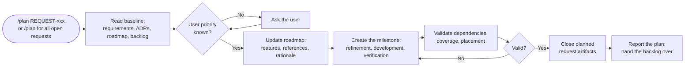

## 3. Planning

Phase 3 turns verified requirements, and `bug` requests, into an **ordered, dependency-safe backlog**. The orchestrator plans with `/plan REQUEST-xxx` for one request, or with `/plan` for every open request. Each enhancement and each technical improvement gets its own milestone; `bug` tasks are packed into one milestone per batch. A milestone is composed of one refinement task, one or more development tasks, and one verification task. Verification may add development correction tasks or reopen refinement, but never adds a second verification task. Planning closes the request artifacts it planned and rejects those it declines. Phase 3 repeats for every request round until the user declares a feature freeze; after the freeze only fix work is planned.

### Inputs and preconditions

- **Verified requirements** from Phase 2, with changed and created requirement and group IDs.
- **Bug request artifacts** with status `open`, routed directly from Phase 1.
- **User ADRs** created between Phases 1 and 2, as fixed business or technical constraints.
- **User priority**: the order in which the user wants requests and requirements delivered.
- **Current plan state**: roadmap, milestones, releases, tasks, dependencies, ordinals.
- **Planning scope**: the request named in `/plan REQUEST-xxx`, or every open request when none is named.

Planning does not start when requirements are not `verified`, a product or business decision is open, or the priority needed for ordering is unknown. The orchestrator reports the blocker instead of inventing order or scope.

### Actors

| Actor                              | Role in Phase 3                                                                |
| ---------------------------------- | ------------------------------------------------------------------------------ |
| `orchestrator`                     | Owner: runs `/plan`, and owns the roadmap, milestones, releases, tasks, dependencies, ordinals |
| User                               | Supplies priority, scope trade-offs, and milestone/release decisions           |
| `requirements-engineer`            | Supplies verified requirements; does not plan                                  |
| `task-refiner`, `*-dev` agents, `quality-gatekeeper` | Execute their task kinds inside a milestone; do not plan the milestone |

### Flow

### Planning elements

| Element    | Definition                                                                                                  | Rule                                                                                                                                          |
| ---------- | ----------------------------------------------------------------------------------------------------------- | --------------------------------------------------------------------------------------------------------------------------------------------- |
| Roadmap    | Ordered feature list with source requirement references and rationale                                       | One position per feature; changes are recorded, never silent                                                                                  |
| Milestone  | One enhancement, one technical improvement, or a batch of `bug` tasks, delivered as a usable increment      | Contains exactly one refinement task, one or more development tasks, and one verification task; completion is derived from the verification task |
| Release    | A version record, open until completed, owning one or more milestones                                       | Created by the orchestrator and stays open to new milestones until the feature freeze; the final version is chosen in Phase 6                 |
| Task       | A task inside a milestone, traceable to requirements or the `bug` request                                   | Outcome-level; assigned to the actor able to fulfill it; refinement completes the development tasks' fields                                   |
| Dependency | A hard ordering constraint declared on a task                                                               | Never a suggestion; cycles are defects                                                                                                        |
| Ordinal    | Position inside a milestone, lower runs first                                                               | Encodes user priority when dependencies allow                                                                                                 |

### Milestone composition

Every milestone uses the same ordered task kinds. Planning decides that the tasks exist and in which order; it does not plan their execution.

| Order | Task         | Purpose                                                                                                                                                                                                                                   | Owner               |
| ----- | ------------ | ----------------------------------------------------------------------------------------------------------------------------------------------------------------------------------------------------------------------------------------- | ------------------- |
| 1     | Refinement   | Architecture impact analysis, technical specification, technical decisions, UI design and mockups when needed, Gherkin test cases, and the development tasks with precise acceptance criteria                                              | `task-refiner`      |
| 2..n  | Development  | Implement one development task and fulfil its acceptance criteria                                                                                                                                                                         | Assigned `*-dev`    |
| last  | Verification | Check that every milestone acceptance criterion is fulfilled, apply the basic code quality gates, run `code-audit` standalone on the milestone change set, and create correction tasks when needed                                                                                                  | `quality-gatekeeper` |

Rules:

- Every milestone has exactly one refinement task, one or more development tasks, and one verification task. There is no milestone build task and no RC package; final packages are built in Phase 6. Verification may add development correction tasks or reopen refinement without changing this composition.
- Refinement comes first. It produces the technical specification, the technical decisions, the UI design and mockups when the milestone needs them, the test cases, and the development tasks.
- Planning creates the milestone's main development tasks; refinement completes them and may add or split development tasks. Their precise acceptance criteria are written by refinement.
- Development starts only after the refinement task is `Done`.
- Verification runs last, after every planned development task is `Done`. It checks all milestone acceptance criteria and the basic code quality gates, and creates correction tasks for failures. The milestone is not complete until the verification task passes.
- Milestone acceptance criteria are written on the milestone when it is planned; development task acceptance criteria belong to refinement.
- Test cases are written as Gherkin scenarios (`GIVEN` / `WHEN` / `THEN`) for the changed requirements and business rules.
- The first milestone of a project establishes the technical specification baseline and the building blocks it is organized by.
- Planning may split a task before refinement; `task-refiner` may add or split development tasks during refinement.
- After every addition or split, dependencies and ordinals are adjusted until the milestone is ordered and dependency-safe.
- `bug` tasks are planned in one batch milestone and follow the same composition: refinement, development, verification.
- Exactly one verification task is planned per milestone. It is the last task planned with the milestone; correction tasks created by it are added after it.

### Prioritisation rules

Applied in this order:

1. **Dependencies first.** Never schedule work before a declared dependency.
2. **User priority.** Among dependency-ready work, lower ordinals go to what the user asked for first.
3. **No unusable increments.** Never schedule a capability before the capability that makes it usable.
4. **Risk and readiness.** Prefer lower-risk, well-understood work that keeps the milestone demonstrable.
5. **Tie-breaker.** Ask the user; never fall back to identifier order.

The orchestrator never invents priority, business value, or capacity.

### Steps

1. **Read the baseline**: verified requirements, user ADRs, bug requests, roadmap, milestones, releases, and current tasks.
2. **Resolve the planning scope**: the request named in `/plan REQUEST-xxx`, or every open request. Stop and ask when the scope or the priority is unknown.
3. **Confirm priority** for the incoming work.
4. **Update the roadmap**: feature order, requirement references, rationale.
5. **Decide the work**: create one milestone per enhancement and per technical improvement, pack available `bug` tasks into a shared milestone, add one refinement task, one or more development tasks, and one verification task, assign each to the actor able to fulfill it, and set dependencies and ordinals.
6. **Validate** the plan.
7. **Close the planned request artifacts**: status `closed`, referencing the requirements and tasks produced. Set `rejected` on artifacts whose remaining items are declined, with the reason.
8. **Report** the plan to the user, including the next eligible item.

### Plan validation

A plan is valid only when:

- every milestone is one enhancement, one technical improvement, or a batch of `bug` tasks;
- every milestone has its acceptance criteria, exactly one refinement task, one or more development tasks, and exactly one verification task, with the verification task last;
- the dependency graph is acyclic;
- every dependency exists and is scheduled earlier;
- no dependency points forward across milestones;
- every verified requirement maps to at least one milestone or task, or to an explicit recorded decision;
- every task references a requirement, a `bug` request, or a `technical-improvement` request with the recorded reason when no requirement is produced;
- every task is assigned to an actor able to fulfill it;
- release assignment and milestone scope are complete;
- ordinals are unambiguous inside each milestone;
- no in-progress task was reordered or re-scoped.

### Request artifact closure

- A request artifact is closed **when its work is planned**, not when requirements are written.
- Closing records the planned requirements and tasks on the artifact.
- Planning sets a `bug` request `in-progress` when its planning starts; it is closed the same way as any request: planned, then close.
- An artifact whose remaining items are rejected becomes `rejected`, with the reason.
- A request artifact is never closed or rejected before its work is planned or its items are rejected.

### Feature freeze

The Phase 1–4 loop repeats until the user declares a feature freeze.

- The freeze is a user decision, not a planning decision; the orchestrator records the frozen milestone scope on the release.
- Planning stops at the freeze: no new requests, requirements, or milestones enter the frozen release.
- After the freeze the orchestrator only creates fix milestones and their tasks for release-audit findings or release failures, and follow-up tasks for owned findings.
- Lifting the freeze is a user decision; only then does normal planning resume.

### Re-planning

A plan defect found during execution — missing dependency, wrong order, missing milestone scope, priority conflict — returns to the orchestrator for a repair. The orchestrator corrects only what the defect requires, revalidates the plan, and reports the correction or `no change needed`.

Refinement may add or split a development task within the plan. Any split that changes dependencies, ordinals, or milestone scope goes back to planning.

Reordering or re-scoping an in-progress task requires the user's agreement first.

A failed release audit, a finding the user wants fixed, or a failed final build adds a **fix milestone** to the release: the orchestrator creates the fix milestone with its refinement, development, and verification tasks, scoped only to what the release needs to become releasable. A deployable component reported without its `<component-dir>/scripts/build-package.sh` during packaging gets a task for its `*-dev` agent, in the fix milestone or in the milestone being built.

### Priority change

The user may change priority at any time, including during implementation.

- A priority change is a planning input, not an execution change: it recalls Phase 3.
- The orchestrator updates the roadmap and recalculates ordinals and dependencies for work that has not started.
- Completed and in-progress work keeps its order.
- The orchestrator revalidates the plan and reports the new order and the next eligible task.
- Implementation resumes from the new order; the stop boundary is restated if it was expressed against the old order.

### Exit criteria

Phase 3 is complete when:

- a valid plan exists, ordered and dependency-ready;
- every open request in scope is planned or explicitly rejected;
- every milestone carries exactly one refinement task, one or more development tasks, and one verification task, with its acceptance criteria on the milestone;
- the request artifacts are closed with their references;
- the orchestrator holds the backlog, the first eligible item, and any open decisions.

No implementation, refinement, or status transition happens here.

### Boundaries

Phase 3 never:

- plans task execution in detail, writes development task acceptance criteria, or defines development task scope; those belong to refinement;
- implements, designs UI, writes specifications, or edits requirements;
- invents priority, capacity, or business value;
- changes requirement meaning or adds scope not covered by Phase 2;
- executes work, changes task status, or marks a task `Done`;
- closes or rejects a request artifact before its work is planned or its items are rejected;
- reorders in-progress work without the user's agreement.

### Stop conditions

- Requirements not `verified` or a decision open: stop, return to Phase 2.
- Priority unknown and needed for ordering: ask; do not guess.
- Dependency cycle, missing dependency, or forward cross-milestone dependency: stop the affected plan.
- In-progress work affected by the new scope: ask before reordering or re-scoping.
- Bug request without a traceable requirement or a clear defect description: return it to Phase 1.
- Milestone or release scope conflict: ask the user.
