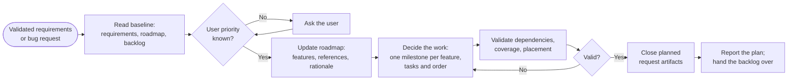

## 3. Planning

Phase 3 turns validated requirements, and `bug` requests, into an **ordered, dependency-safe backlog**. Each new or changed feature is packed into its own milestone; bugs become tasks tagged `bug` and share a milestone when several are available. Planning closes the request artifacts it planned.

Phase position: `Phase 2 → Phase 3 → Phase 4 Implementation`. The `Backlog` artifact is defined in [artifacts.md](./artifacts.md).

### Inputs and preconditions

- **Validated requirements** from Phase 2, with changed and created requirement and group IDs, plus impact flags (architecture, specification, UI, NFR, integration).
- **Bug request artifacts** with status `open`, routed directly from Phase 1.
- **User priority**: the order in which the user wants requests and requirements delivered.
- **Current plan state**: roadmap, milestones, releases, work items, dependencies, ordinals.

Planning does not start when requirements are unvalidated, a product or business decision is open, or the priority needed for ordering is unknown. The planner reports the blocker instead of inventing order or scope.

### Actors

| Actor | Role in Phase 3 |
|---|---|
| `planner` | Owner: roadmap, milestones, releases, work items, dependencies, ordinals |
| `orchestrator` | Starts planning and receives the ordered backlog; never plans or reorders |
| User | Supplies priority, scope trade-offs, and milestone/release decisions |
| `requirements-engineer` | Supplies validated requirements; does not plan |
| `architect`, `ui-designer`, `task-refiner`, dev agents | Own task kinds inside a milestone; do not plan the milestone |

### Flow

### Planning elements

| Element | Definition | Rule |
|---|---|---|
| Roadmap | Ordered feature list with source requirement references and rationale | One position per feature; changes are recorded, never silent |
| Milestone | One new or changed feature, or a batch of `bug` tasks, delivered as a usable increment | Has no status; completion is derived from its work items |
| Release | A version record with acceptance criteria, owning one or more milestones | Created and assigned by the planner; the version is fixed at release time, once all changes are known |
| Work item | A task inside a milestone, traceable to requirements or the bug request | Outcome-level; assigned to the actor able to fulfil it; details come from refinement |
| Dependency | A hard ordering constraint declared on a work item | Never a suggestion; cycles are defects |
| Ordinal | Position inside a milestone, lower runs first | Encodes user priority when dependencies allow |

### Milestone composition

Every feature milestone contains the same task sequence. Planning decides that the tasks exist and in which order; it does not plan their execution.

| Order | Task | Purpose | Owner |
|---|---|---|---|
| 1 | Architecture impact assessment | Judge architectural impact and needed decisions; blocks dependent work when unresolved | `architect` |
| 2 | UI design | UI specification and mockup, only when the planner decides it is needed | `ui-designer` |
| 3 | Refinement | Confirm that all information needed for development is available, and produce the development plan | `task-refiner` |
| 4 | Implementation | Development and automated tests | Dev agents |
| 5 | Milestone validation | Carry the milestone and feature acceptance criteria, and verify the increment against them | `quality-gatekeeper` |

Rules:

- The architecture impact assessment comes first in every feature milestone.
- The UI design task exists only when the planner decides the feature has UI impact.
- Refinement does not start before the architecture impact is settled and any UI task is planned.
- Implementation does not start before refinement has produced the development plan.
- Milestone validation closes the milestone; it does not replace release verification.
- The milestone and feature acceptance criteria are written into the validation task when the milestone is planned.
- The planner may split a task before refinement; `task-refiner` may split implementation tasks during refinement.
- After every addition or split, dependencies and ordinals are adjusted until the milestone is ordered and dependency-safe.
- Bugs are planned as tasks tagged `bug`; when several are available they are packed into one milestone and follow the same sequence, with architecture and UI tasks only when the planner decides they apply.
- A new project gets bootstrap work (domain model and technical stack) before its first feature milestone.

### Prioritisation rules

Applied in this order:

1. **Dependencies first.** Never schedule work before a declared dependency.
2. **User priority.** Among dependency-ready work, lower ordinals go to what the user asked for first.
3. **No unusable increments.** Never schedule a capability before the capability that makes it usable.
4. **Risk and readiness.** Prefer lower-risk, well-understood work that keeps the milestone demonstrable.
5. **Tie-breaker.** Ask the user; never fall back to identifier order.

The planner never invents priority, business value, capacity, or criticality. Severity recorded in intake is not priority.

### Steps

1. **Read the baseline**: validated requirements, impact flags, bug requests, roadmap, milestones, releases, and current work items.
2. **Confirm priority** for the incoming work; stop and ask when it is unknown.
3. **Update the roadmap**: feature order, requirement references, rationale.
4. **Decide the work**: pack each new or changed feature into its own milestone, pack available `bug` tasks into a shared milestone, add the tasks in the required sequence, assign each to the actor able to fulfil it, split where useful, and set dependencies and ordinals.
5. **Validate** the plan.
6. **Close the planned request artifacts**: status `closed`, referencing the requirements and work items produced. Also close artifacts whose remaining items were rejected.
7. **Report** the plan and hand the backlog to the orchestrator, including the first eligible item.

### Plan validation

A plan is valid only when:

- every milestone is one feature or a batch of `bug` tasks, and has the required task sequence;
- every milestone validation task states the milestone and feature acceptance criteria;
- the dependency graph is acyclic;
- every dependency exists and is scheduled earlier;
- no dependency points forward across milestones;
- every validated requirement maps to at least one work item, or to an explicit recorded decision;
- every work item references a requirement or a bug request;
- every work item is assigned to an actor able to fulfil it;
- release assignment and milestone scope are complete;
- ordinals are unambiguous inside each milestone;
- no in-progress work item was reordered or re-scoped.

### Request artifact closure

- A request artifact is closed **when its work is planned**, not when requirements are written.
- Closing records the planned requirements and work items on the artifact.
- Bug request artifacts are closed the same way: planned, then close.
- An artifact whose remaining items were rejected is closed with the reason.
- A request artifact is never closed before its work is planned or its items are rejected.

### Re-planning

A plan defect found during execution — missing dependency, wrong order, missing milestone scope, priority conflict — returns to the planner for a repair. The planner corrects only what the defect requires, revalidates the plan, and reports the correction or `no change needed`.

Refinement may split a task within the plan. Any split that changes dependencies, ordinals, or milestone scope goes back to the planner.

Reordering or re-scoping an in-progress work item requires the user's agreement first.

### Priority change

The user may change priority at any time, including during implementation.

- A priority change is a planning input, not an execution change: it recalls Phase 3.
- The planner updates the roadmap and recalculates ordinals and dependencies for work that has not started.
- Completed and in-progress work keeps its order.
- The planner revalidates the plan and reports the new order and the next eligible task.
- Implementation resumes from the new order; the stop boundary is restated if it was expressed against the old order.

### Exit criteria

Phase 3 is complete when:

- a valid plan exists, ordered and dependency-ready;
- every incoming requirement or bug request is planned or explicitly rejected;
- every milestone carries its architecture, optional UI, refinement, implementation, and validation tasks, with the acceptance criteria in the validation task;
- the request artifacts are closed with their references;
- the orchestrator holds the backlog, the first eligible item, and any open decisions.

No implementation, refinement, or status transition happens here.

### Boundaries

Phase 3 never:

- plans task execution in detail, writes ticket-level acceptance criteria, or defines ticket-level scope; milestone acceptance criteria belong to the validation task;
- implements, designs UI, writes specifications, or edits requirements;
- invents priority, capacity, or business value;
- changes requirement meaning or adds scope not covered by Phase 2;
- executes work, changes work-item status, or marks work `Done`;
- closes a request artifact before its work is planned or rejected;
- reorders in-progress work without the user's agreement.

### Stop conditions

- Requirements unvalidated or a product/business decision open: stop, return to Phase 2.
- Priority unknown and needed for ordering: ask; do not guess.
- Dependency cycle, missing dependency, or forward cross-milestone dependency: stop the affected plan.
- In-progress work affected by the new scope: ask before reordering or re-scoping.
- Bug request without a traceable requirement or a clear defect description: return it to Phase 1.
- Milestone or release scope conflict: ask the user.

### Open points

- The owner of milestone validation is not yet confirmed; `quality-gatekeeper` is assumed.
