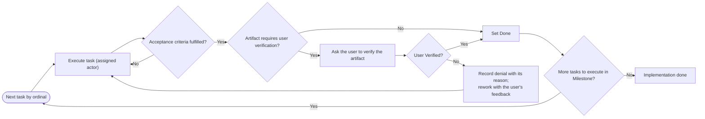

## 4. Implementation

Phase 4 executes the planned backlog in ordinal order until the user's stop boundary, a blocker, or the end of the backlog. The tasks inside a milestone are the unit of work; there is no separate verification phase for each task beyond the required artifact verifications.

Phase position: `Phase 3 → Phase 4 → Phase 5 Verification`.

### Inputs and preconditions

- **Prioritized backlog** from Phase 3: ordered by ordinal, with milestones, assigned actors, and dependencies.
- **Stop boundary**: the user states up to which task execution continues automatically, or can request a stop at any time.
- **Task statuses**: `To Do`, `In-Progress`, and `Done`; `archived` when cleaned up.

A missing plan, an unassigned task, or an unordered backlog returns to Phase 3.

### Actors

| Actor                                                                                      | Role in Phase 4                                                                                                |
| ------------------------------------------------------------------------------------------ | -------------------------------------------------------------------------------------------------------------- |
| `orchestrator`                                                                             | Drives execution, selects tasks, sets statuses, records fulfilment proof, reports; never edits project content |
| Task owners (`architect`, `ui-designer`, `task-refiner`, `tech-writer`, any `*-dev` agent) | Execute their assigned tasks                                                                                   |
| `test-manager`                                                                             | Writes the Gherkin test cases (`GIVEN` / `WHEN` / `THEN`) for the requirements and business rules              |
| `quality-gatekeeper`                                                                       | Runs the milestone verification checks in Phase 5; not a Phase 4 executor                                      |
| `planner`                                                                                  | Owns plan repairs and priority changes; never executes                                                         |
| User                                                                                       | Sets priority and stop boundary, and verifies the artifacts that require it                                    |

### Flow

### Task model

| Status        | Meaning                                                                                                                |
| ------------- | ---------------------------------------------------------------------------------------------------------------------- |
| `To Do`       | Planned, not started                                                                                                   |
| `In-Progress` | Being executed, including rework after a failed acceptance check or a denied user verification                         |
| `Done`        | Every acceptance criterion is fulfilled and, when the task's artifact requires it, the user's verification is obtained |
| `archived`    | Cleaned up; hidden from the backlog                                                                                    |

- A task is `Done` when all its acceptance criteria are fulfilled and any required artifact verification is obtained; no other user approval is requested.
- Fulfillment proof is recorded on the task when it becomes `Done`; its format follows the nature of the acceptance criteria (test results, document or mockup verification, review output) and is defined per task.
- Task kinds come from the milestone composition in Phase 3: architecture impact assessment, UI design, test design, refinement, implementation, and milestone verification.
- When a task is `Done`, the orchestrator integrates its `task/<TASK-ID>` branch with `git merge --no-ff`; fast-forward merges are never used.
- The milestone verification task belongs to the milestone but is not selected as a Phase 4 task; it is executed at the milestone boundary in Phase 5, and the milestone is not complete until it is `Done`.
- Correction tasks created in Phase 5 are created by the `planner` at the reviewer's request; the reviewer who found the failure defines the task's content — the failure description and the criteria it blocks. They are added to the milestone within its approved scope, complete the unfulfilled scope without changing it, are executed before the milestone is re-verified, and do not change the prioritized order. Scope, dependency, or ordinal changes, if ever required, go to the planner.

### Selection and order

1. Resume the lowest-ordinal `In-Progress` task first.
2. Otherwise take the lowest-ordinal `To Do` task whose dependencies are all `Done`.
3. Never ask the user to choose among eligible tasks; ordinal is the priority.
4. Completed order stands; execution never reorders tasks locally.

### Stop boundary

- The user may state, before or during execution, the last task to complete automatically.
- Execution stops after that task is `Done`; the next task is not started.
- Every milestone end is a stop point: execution stops when the milestone's last execution task is `Done`, regardless of the boundary.
- On a stop request, the current task is finished: if its acceptance criteria are met it becomes `Done`, otherwise it stays `In-Progress` and the state is reported.
- The boundary is recorded in the session and not in the backlog; a new invocation restates it if needed.
- Without a boundary, execution continues until the backlog ends, a blocker appears, or a pending verification holds the task at the ask step.

### Verification gates

Some tasks produce an artifact that must be verified by the user before dependent work can start. This is artifact verification, not an approval gate for the milestone itself. A positively completed verification approves the artifact; the artifact's `approved` state records that result. The order is fixed: the acceptance criteria are checked first, then the verification. When a task's artifact requires user verification, execution asks the user to verify it. If the user denies the verification, the denial is recorded with its reason and the task returns to rework with the user's feedback: the acceptance criteria are checked again and the ask step runs again afterwards. The task stays `In-Progress` the whole time and is `Done` only once verified. A task whose artifact requires no verification is `Done` on its acceptance criteria alone.

| Task or artifact               | Required user verification                                                | Before                              |
| ------------------------------ | ------------------------------------------------------------------------- | ----------------------------------- |
| Architecture impact assessment | Architecture verified by the user; decisions accepted                     | Dependent design and implementation |
| UI design                      | Mockup explicitly verified by the user                                    | Implementing the affected UI        |
| Test design                    | Test cases verified by the user                                           | Refinement and implementation       |
| Technical specification        | Conformance with the architecture and decisions verified by the architect | Refinement                          |
| Milestone verification         | Confirms the milestone acceptance criteria                                | Milestone is complete               |
| Any task                       | None beyond its own acceptance criteria                                   | —                                   |

No end-of-task approval is requested beyond the required artifact verification: a passing acceptance check, plus the verification where one applies, sets the task `Done`.

### Milestone handling

- A milestone's execution tasks are its architecture impact assessment, UI design, test design, refinement, and implementation tasks. Phase 4 stops when the last of them is `Done`.
- The milestone is not complete until its milestone verification task passes in Phase 5; the next milestone starts from a new invocation.
- The milestone carries its acceptance criteria; the verification task checks them.
- If milestone verification fails, the implementation tasks responsible for the failing acceptance criteria return to `In-Progress` and are reworked; the failing criteria determine which tasks reopen. The milestone is not reported complete.
- The milestone boundary is reported, not approved.

### Task outcome and rework

- Acceptance criteria not met: the task stays `In-Progress` and work continues; there is no intermediate status.
- A task blocked by a missing decision, missing dependency, or missing information stops execution and is reported. Execution does not invent the missing input.
- A defect found in the implementation reopens the task to `In-Progress`; it does not create unplanned work.
- A denied user verification returns the task to rework with the user's feedback; the ask step runs again after rework. It does not create unplanned work.
- New scope discovered during implementation stops execution and returns to Phase 2 or 3; it is never absorbed silently.

### Priority and re-planning

- Execution order comes from the prioritized backlog, i.e. the planned ordinals; the orchestrator never reorders.
- A user priority change recalls Phase 3; execution resumes from the new order once the plan is revalidated.
- Work already `Done` or `In-Progress` keeps its place.
- A plan defect (missing dependency, wrong order, missing scope) stops execution and returns to the planner.

### Exit criteria

Phase 4 is complete when:

- the stop boundary is reached, a milestone's execution tasks complete, the user stops execution, or the backlog is exhausted;
- every executed task is `Done` or explicitly reported as `In-Progress` with its blocker;
- every milestone whose execution tasks are `Done` is reported as ready for Phase 5 verification;
- the report states tasks completed in order, fulfilment proof, milestone boundaries reached, remaining work, and the reason execution stopped.

Release-level verification and audits are not Phase 4 work.

### Boundaries

Phase 4 never:

- refines scope, writes requirements, or reorders tasks; refinement splits follow the Phase 3 rule and go through the planner for dependencies and ordinals;
- changes priority, dependencies, ordinals, or milestone scope; correction tasks stay within the approved scope;
- starts a task whose dependencies are not `Done`;
- marks a task `Done` with an unmet acceptance criterion or a missing required verification;
- asks for end-of-task approval beyond the defined artifact verifications;
- skips a verification-required artifact;
- absorbs new scope discovered during execution.

### Stop conditions

- Dependency not `Done` or a task unassigned: report and stop.
- A required artifact verification is denied: record the denial with its reason, keep the task `In-Progress`, rework with the user's feedback, and ask again after rework; dependent work does not start. A verification that is simply pending (the user has not responded) holds the task at the ask step.
- Acceptance criteria cannot be met with the current information: stop and return to Phase 2 or 3.
- Milestone verification fails and rework does not resolve it: stop and report.
- Priority or scope conflict: stop and return to Phase 3.
- User requests a stop: finish the current task, then stop.
