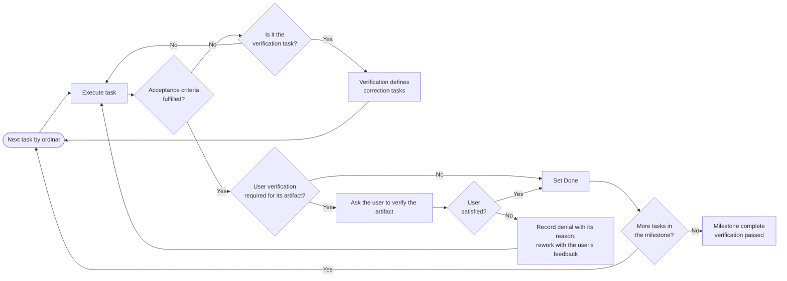

## 4. Implementation

Phase 4 executes the planned backlog in ordinal order until the user's stop boundary, a blocker, the end of the backlog, or the user's feature freeze. Each milestone runs its refinement, development, and verification tasks; a milestone is complete only when its verification task passes. Phases 1 to 4 repeat for every request round until the freeze.

Phase position: `Phase 3 → Phase 4 → (next request round | Phase 5 Audit at the feature freeze)`.

### Inputs and preconditions

- **Prioritized backlog** from Phase 3: ordered by ordinal, with milestones, assigned actors, and dependencies.
- **Stop boundary**: the user states up to which task execution continues automatically, or can request a stop at any time.
- **Task statuses**: `To Do`, `In-Progress`, and `Done`; `archived` when cleaned up.

A missing plan, an unassigned task, or an unordered backlog returns to Phase 3.

### Actors

| Actor                                | Role in Phase 4                                                                                          |
| ------------------------------------ | -------------------------------------------------------------------------------------------------------- |
| `orchestrator`                       | Drives execution, selects tasks, sets statuses, records fulfilment proof, reports; never edits project content |
| `task-refiner`                       | Executes the milestone's refinement task and writes its artifacts                                        |
| Assigned `*-dev` agent               | Executes the development tasks                                                                           |
| `quality-gatekeeper`                 | Executes the milestone verification task and defines correction tasks                                    |
| User                                 | Verifies the mockups and test cases, and decides when a decision is required                             |

### Flow

### Task model

| Status        | Meaning                                                                                                                |
| ------------- | ---------------------------------------------------------------------------------------------------------------------- |
| `To Do`       | Planned, not started                                                                                                   |
| `In-Progress` | Being executed, including rework after a failed acceptance check or a denied user verification                         |
| `Done`        | Every acceptance criterion is fulfilled and, when the task's artifact requires it, the user's verification is obtained |
| `archived`    | Cleaned up; hidden from the backlog                                                                                    |

- A task is `Done` when all its acceptance criteria are fulfilled and any required artifact verification is obtained.
- Fulfilment proof is recorded on the task when it becomes `Done`; its format follows the nature of the acceptance criteria (test results, document or mockup verification, review output) and is defined per task.
- Task kinds come from the milestone composition in Phase 3: refinement, development, and verification. Correction tasks created by verification are development tasks; a defect in a refinement artifact reopens the refinement task instead.
- When a task is `Done`, the orchestrator integrates its `task/<TASK-ID>` branch with `git merge --no-ff`; fast-forward merges are never used.
- Fix tasks created after the freeze are created by the orchestrator at the user's request; the audit or review that reported the finding defines the task's content — the failure description and the criteria it blocks. They belong to a fix milestone, complete the unfulfilled scope without changing it, and do not change the prioritized order.

### Refinement

The refinement task makes the milestone implementation-ready. `task-refiner` fulfils it with its skills and produces:

| Goal                          | Output                                                                                                                                                                                             |
| ----------------------------- | -------------------------------------------------------------------------------------------------------------------------------------------------------------------------------------------------- |
| Architecture impact analysis  | The technical specification sections for the milestone, and the technical decisions on how the milestone will be implemented as a whole                                                             |
| UI design, when needed        | The UI specification entries and the mockups describing what the UI does                                                                                                                           |
| Test-case design              | The Gherkin test cases (`GIVEN` / `WHEN` / `THEN`) for the changed requirements and business rules                                                                                                 |
| Development task creation     | One or more development tasks derived from the architecture impact analysis and the technical specification, each with precise acceptance criteria                                                |

- Refinement covers the milestone as a whole; it does not implement code.
- When the milestone has no UI impact, refinement records that explicitly instead of producing UI artifacts.
- Mockups and test cases are verified by the user before the development tasks that depend on them start.
- Refinement is `Done` when the technical specification and technical decisions, the UI artifacts or the explicit no-UI note, the test cases, and the development tasks with their acceptance criteria exist.
- Refinement may add or split development tasks. Changes to dependencies, ordinals, or milestone scope go back to Phase 3.

### Development

- An assigned `*-dev` agent completes one development task and ensures every acceptance criterion is fulfilled.
- The agent implements the code and its automated tests, including the integration tests for the refinement's test cases.
- Fulfilment proof — test results and, where the task defines them, review or verification evidence — is recorded on the task.
- A development task that does not fulfil its acceptance criteria stays `In-Progress`.
- New scope discovered during development stops execution and returns to Phase 2 or 3; it is never absorbed silently.

### Milestone verification

- Every milestone has exactly one verification task; it is the last task planned with the milestone. Correction tasks created by it come after it in ordinal order.
- It checks every milestone acceptance criterion and records pass/fail with evidence.
- It assesses the basic code quality gates: the build succeeds, the automated test suite passes, the project's linting and style checks pass, and no critical issue remains in the changed code.
- It runs `code-audit` standalone on the milestone's change set for complexity, duplication, naming, structure, test coverage, and style. This is not the Phase 5 release audit and creates no audit record.
- A failed criterion, gate, or code-audit finding becomes a correction task with its failure description and the criterion it blocks. The orchestrator assigns it, a `*-dev` fulfils it, and verification reruns. The failed verification task stays `In-Progress` and yields until every correction task is `Done`. A defect in a refinement artifact reopens the refinement task instead of creating a correction task.
- The verification task is `Done` only when every milestone acceptance criterion, every basic quality gate, and every standalone code-audit finding passes. It is read-only: it never fixes code.
- The milestone is complete when its verification task is `Done`; completion is derived, not approved.
- There is no RC build, no RC version, and no milestone package. Final packages are built in Phase 6.

### Verification gates

Some refinement artifacts must be verified by the user before dependent work starts. This is artifact verification, not an approval gate for the milestone. A positively completed verification approves the artifact; the artifact's `approved` state records that result. The order is fixed: the acceptance criteria are checked first, then the verification.

| Artifact             | Required user verification                | Before                        |
| -------------------- | ----------------------------------------- | ----------------------------- |
| UI Mockups           | Mockup explicitly verified by the user    | Implementing the affected UI  |
| Test Case            | Test cases verified by the user           | Development of the milestone  |
| Any other task       | None beyond its own acceptance criteria   | —                             |

No end-of-task approval is requested beyond the required artifact verification: a passing acceptance check, plus the verification where one applies, sets the task `Done`.

### Selection and order

1. Resume the lowest-ordinal `In-Progress` task first, except a failed verification task, which waits until its correction tasks are `Done`.
2. Otherwise take the lowest-ordinal `To Do` task whose dependencies are all `Done`.
3. Never ask the user to choose among eligible tasks; ordinal is the priority.
4. Completed order stands; execution never reorders tasks locally.
5. Correction tasks are ordered after the verification task that created them and before its rerun.

### Stop boundary

- The user may state, before or during execution, the last task to complete automatically.
- Execution stops after that task is `Done`; the next task is not started.
- Every milestone end is a stop point: execution stops when the milestone's verification task is `Done`, regardless of the boundary.
- On a stop request, the current task is finished: if its acceptance criteria are met it becomes `Done`, otherwise it stays `In-Progress` and the state is reported.
- The boundary is recorded in the session and not in the backlog; a new invocation restates it if needed.
- Without a boundary, execution continues until the backlog ends, a blocker appears, or a pending verification holds the task at the ask step.

### Task outcome and rework

- Acceptance criteria not met: the task stays `In-Progress` and work continues; there is no intermediate status.
- A task blocked by a missing decision, missing dependency, or missing information stops execution and is reported. Execution does not invent the missing input.
- A defect found in the implementation reopens the task to `In-Progress`; it does not create unplanned work.
- A denied user verification returns the task to rework with the user's feedback; the ask step runs again after rework. It does not create unplanned work.
- A failed milestone verification creates correction tasks inside the milestone; it does not change the milestone scope.
- New scope discovered during implementation stops execution and returns to Phase 2 or 3; it is never absorbed silently.

### Priority and re-planning

- Execution order comes from the prioritized backlog, i.e. the planned ordinals; the orchestrator never reorders during execution.
- A user priority change recalls Phase 3; execution resumes from the new order once the plan is revalidated.
- Work already `Done` or `In-Progress` keeps its place.
- A plan defect (missing dependency, wrong order, missing scope) stops execution and returns to re-planning.

### Feature freeze

- The user declares the freeze; execution finishes the current task and stops.
- No new refinement, development, or verification work starts, except in a fix milestone created after the freeze.
- The orchestrator records the frozen milestone scope, and `quality-gatekeeper` runs the Phase 5 release audit over the whole codebase.

### Exit criteria

Phase 4 is complete when:

- the stop boundary is reached, the user stops execution, the feature freeze is declared, or the backlog is exhausted;
- every executed task is `Done` or explicitly reported as `In-Progress` with its blocker;
- every completed milestone has its verification task `Done`, including the standalone code audit, or the milestone is reported as incomplete with the failed criterion;
- the report states tasks completed in order, fulfilment proof, milestone boundaries reached, standalone code-audit results, remaining work, and the reason execution stopped.

The release audit, final packaging, and deployment are not Phase 4 work.

### Boundaries

Phase 4 never:

- refines scope, writes requirements, or reorders tasks; refinement changes to dependencies or ordinals go through Phase 3;
- changes priority, dependencies, ordinals, or milestone scope;
- starts a task whose dependencies are not `Done`;
- marks a task `Done` with an unmet acceptance criterion or a missing required verification;
- asks for end-of-task approval beyond the defined artifact verifications;
- skips a verification-required artifact;
- lets verification fix code, or lets a development agent verify its own milestone;
- absorbs new scope discovered during execution;
- runs the Phase 5 release audit;
- starts new work after the feature freeze, except fix tasks in a fix milestone.

### Stop conditions

- Dependency not `Done` or a task unassigned: report and stop.
- A required artifact verification is denied: record the denial with its reason, keep the task `In-Progress`, rework with the user's feedback, and ask again after rework; dependent work does not start. A verification that is simply pending (the user has not responded) holds the task at the ask step.
- Acceptance criteria cannot be met with the current information: stop and return to Phase 2 or 3.
- A milestone verification cannot pass and correction tasks cannot resolve it within the milestone scope: stop and report; the user decides on scope.
- Priority or scope conflict: stop and return to Phase 3.
- User declares the feature freeze: finish the current task and stop; `quality-gatekeeper` runs the release audit.
- User requests a stop: finish the current task, then stop.
