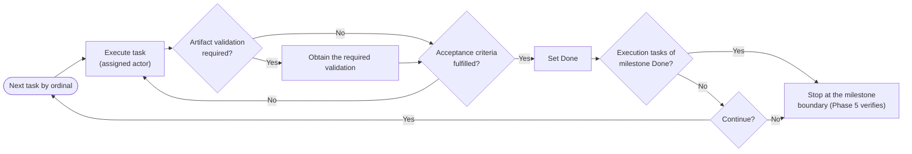

## 4. Implementation

Phase 4 executes the planned backlog in ordinal order until the user's stop boundary, a blocker, or the end of the backlog. The tasks inside a milestone are the unit of work; there is no separate validation phase for each task.

Phase position: `Phase 3 → Phase 4 → Phase 5 Verification`.

### Inputs and preconditions

- **Prioritized backlog** from Phase 3: ordered by ordinal, with milestones, assigned actors, and dependencies.
- **Stop boundary**: the user states up to which task execution continues automatically, or can request a stop at any time.
- **Task statuses**: only `To Do`, `In-Progress`, and `Done`.

A missing plan, an unassigned task, or an unordered backlog returns to Phase 3.

### Actors

| Actor                                                                                      | Role in Phase 4                                                                                        |
| ------------------------------------------------------------------------------------------ | ------------------------------------------------------------------------------------------------------ |
| `orchestrator`                                                                             | Drives execution, selects tasks, sets statuses, records evidence, reports; never edits project content |
| Task owners (`architect`, `ui-designer`, `task-refiner`, `tech-writer`, any `*-dev` agent) | Execute their assigned tasks                                                                           |
| `quality-gatekeeper`                                                                       | Runs the milestone verification task                                                                   |
| `planner`                                                                                  | Owns plan repairs and priority changes; never executes                                                 |
| User                                                                                       | Sets priority and stop boundary, and validates the artifacts that require it                           |

### Flow

### Task model

| Status        | Meaning                                                          |
| ------------- | ---------------------------------------------------------------- |
| `To Do`       | Planned, not started                                             |
| `In-Progress` | Being executed, including rework after a failed acceptance check |
| `Done`        | Every acceptance criterion of the task is fulfilled              |

- There are no other task statuses. A task never returns to `To Do`.
- A task is `Done` when all its acceptance criteria are fulfilled; no user approval is required.
- Evidence is recorded on the task when it becomes `Done`; its format follows the nature of the acceptance criteria (test results, document or mockup approval, review output) and is defined per task.
- Task kinds come from the milestone composition in Phase 3: architecture impact assessment, UI design, refinement, implementation, and milestone verification.
- The milestone verification task belongs to the milestone but is not selected as a Phase 4 work item; it is executed at the milestone boundary in Phase 5, and the milestone is not complete until it is `Done`.
- Correction tasks created in Phase 5 are added to the milestone within its approved scope, executed before it is re-verified, and do not change the prioritized order; the planner decides any scope, dependency, or ordinal change.

### Selection and order

1. Resume the lowest-ordinal `In-Progress` task first.
2. Otherwise take the lowest-ordinal `To Do` task whose dependencies are all `Done`.
3. Never ask the user to choose among eligible tasks; ordinal is the priority.
4. Completed order stands; execution never reorders tasks locally.

### Stop boundary

- The user may state, before or during execution, the last task to complete automatically.
- Execution stops after that task is `Done`; the next task is not started.
- Every milestone end is a stop point: execution stops when the milestone's last execution task is `Done`, regardless of the boundary.
- On a stop request, the current task is finished: if its acceptance criteria are met it becomes `Done`, otherwise it stays `In-Progress` and the state is reported.
- The boundary is recorded in the session and not in the backlog; a new invocation restates it if needed.
- Without a boundary, execution continues until the backlog ends, a blocker appears, or a validation is refused.

### Validation gates

Some tasks produce an artifact that must be explicitly validated before dependent work can start. This is artifact validation, not an approval gate for the milestone itself.

| Task or artifact               | Required validation                                                 | Before                              |
| ------------------------------ | ------------------------------------------------------------------- | ----------------------------------- |
| Architecture impact assessment | Decisions accepted by the user; alternatives and rationale recorded | Dependent design and implementation |
| UI design                      | Mockup explicitly approved by the user                              | Implementing the affected UI        |
| Milestone verification         | Confirms the milestone and feature acceptance criteria              | Milestone is complete               |
| Any task                       | None beyond its own acceptance criteria                             | —                                   |

No end-of-task approval is requested. A passing acceptance check sets the task `Done` and execution moves to the next task.

### Milestone handling

- A milestone's execution tasks are its architecture impact assessment, UI design, refinement, and implementation tasks. Phase 4 stops when the last of them is `Done`.
- The milestone is not complete until its milestone verification task passes in Phase 5; the next milestone starts from a new invocation.
- The milestone verification task carries the milestone and feature acceptance criteria.
- If milestone verification fails, the implementation tasks responsible for the failing acceptance criteria return to `In-Progress` and are reworked; the failing criteria determine which tasks reopen. The milestone is not reported complete.
- The milestone boundary is reported, not approved.

### Task outcome and rework

- Acceptance criteria not met: the task stays `In-Progress` and work continues; there is no intermediate status.
- A task blocked by a missing decision, missing dependency, or missing information stops execution and is reported. Execution does not invent the missing input.
- A defect found in the implementation reopens the task to `In-Progress`; it does not create unplanned work.
- New scope discovered during implementation stops execution and returns to Phase 2 or 3; it is never absorbed silently.

### Priority and re-planning

- Execution order comes from the prioritized backlog, i.e. the planned ordinals; the orchestrator never reorders.
- A user priority change recalls Phase 3; execution resumes from the new order once the plan is revalidated.
- Work already `Done` or `In-Progress` keeps its place.
- A plan defect (missing dependency, wrong order, missing scope) stops execution and returns to the planner.

### Exit criteria

Phase 4 is complete when:

- the stop boundary is reached, a milestone's execution tasks complete, the user stops execution, or the backlog is exhausted;
- every executed task is `Done` or explicitly reported as `In-Progress` with its blocker;
- every milestone whose execution tasks are `Done` is reported as ready for Phase 5 verification;
- the report states tasks completed in order, evidence, milestone boundaries reached, remaining work, and the reason execution stopped.

Release-level verification and audits are not Phase 4 work.

### Boundaries

Phase 4 never:

- refines scope, writes requirements, or reorders tasks; refinement splits follow the Phase 3 rule and go through the planner for dependencies and ordinals;
- changes priority, dependencies, ordinals, or milestone scope; correction tasks stay within the approved scope;
- starts a task whose dependencies are not `Done`;
- marks a task `Done` with an unmet acceptance criterion;
- asks for end-of-task approval; only the defined artifact validations apply;
- skips a validation-required artifact;
- absorbs new scope discovered during execution.

### Stop conditions

- Dependency not `Done` or a task unassigned: report and stop.
- A required artifact validation is refused: stop the dependent work.
- Acceptance criteria cannot be met with the current information: stop and return to Phase 2 or 3.
- Milestone verification fails and rework does not resolve it: stop and report.
- Priority or scope conflict: stop and return to Phase 3.
- User requests a stop: finish the current task, then stop.
