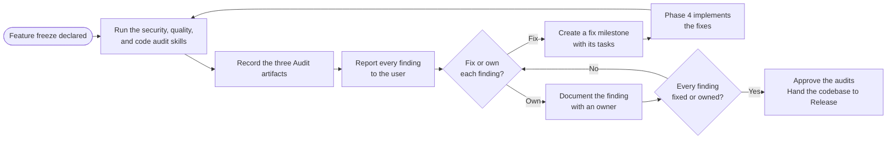

## 5. Audit

Phase 5 runs once per **feature freeze** and audits the **whole frozen codebase**, not a milestone. Each audit is a skill with its own output artifact, run by the `orchestrator`:

| Audit          | Skill            | Output artifact          |
| -------------- | ---------------- | ------------------------ |
| Security audit | `security-audit` | Audit (type `security`)  |
| Quality audit  | `quality-audit`  | Audit (type `quality`)   |
| Code audit     | `code-audit`     | Audit (type `code`)      |

The three audits answer independent questions:

- **Quality audit** — is every feature implemented properly, against its requirements, business rules, and acceptance criteria?
- **Code audit** — is the code maintainable and evolvable, and does it follow the code guidelines?
- **Security audit** — can the software be exploited?

Phase 5 records the findings; the user decides per finding whether to fix it or own it. Phase 5 never fixes, versions, packages, deploys, approves, or releases.

Phase position: `Phase 4 → Phase 5 (at feature freeze) → Phase 6 Release`.

### Feature freeze

The freeze is the trigger and the scope of Phase 5.

- The user declares the freeze; it is recorded on the release with its timestamp (with timezone) and the frozen milestone scope.
- The freeze stops the Phase 1–4 loop: no new requests, requirements, scope, or features. Only fixes to audit findings are allowed while the freeze holds.
- The audit baseline is the commit of the last completed milestone; the audits cover that committed tree.
- Without a recorded freeze, no audit runs.
- Keeping or lifting the freeze is a user decision; lifting it returns the work to the Phase 1–4 loop.

### Inputs and preconditions

- **Recorded feature freeze** with the frozen milestone scope.
- **Complete milestones**: every task of every frozen milestone is `Done`, including each milestone's verification task.
- **Baseline**: the commit SHA of the last completed milestone.
- **Evidence**: task fulfilment proof, test output, requirements (REQ/NFR), business rules, specifications, decisions, and source code.
- **Audit input**: the whole codebase and test suite at the baseline commit.

Phase 4 verifies each milestone. Phase 5 audits the frozen codebase independently and reruns the checks rather than trusting the reported evidence.

### Actors

| Actor          | Role in Phase 5                                                                                                              |
| -------------- | ---------------------------------------------------------------------------------------------------------------------------- |
| `orchestrator` | Runs each audit skill, records the three Audit artifacts, reports findings, and creates the fix milestone when the user chooses a fix |
| User           | Declares the freeze and decides for every finding whether it is fixed or owned                                               |
| `*-dev` agents, `task-refiner` | Execute fix work only after the user's decision, through a fix milestone in Phase 4                           |

The audits are read-only. The orchestrator records them but never fixes what they find, and the actor that fixes a finding never audits the fix.

### Flow

### Audits

- One audit per type per freeze: security, quality, and code, each covering the whole frozen codebase.
- Each audit is recorded as its own artifact with identifier, scope, severity-ranked findings with evidence, recommendation, and verdict.
- All checks cover the frozen codebase, including code unchanged since the last release.
- Every finding is severity-ranked with evidence, location, and recommendation; the scale is `low`, `medium`, `high`, `blocker`.
- Every finding gets a decision: `fix` or `own`. A finding is never left undecided.
- Findings are rerun or re-read from evidence; a reported result is not accepted on trust.

| Audit          | Verifies                                                                                                                                       |
| -------------- | ---------------------------------------------------------------------------------------------------------------------------------------------- |
| Quality audit  | Requirement and milestone acceptance-criteria coverage, business rules, NFR coverage, scope creep, rerun tests                                  |
| Code audit     | Complexity, duplication, naming, structure, test coverage, code-guideline compliance of the whole codebase and test suite                      |
| Security audit | Secrets, dependency supply chain, authentication and authorization, input handling, data protection, platform risks, cross-feature risks        |

### Finding decisions

The user decides for every finding, and Phase 5 records the decision:

| Decision | Effect                                                                                                                                                                              |
| -------- | ----------------------------------------------------------------------------------------------------------------------------------------------------------------------------------- |
| `fix`    | The finding becomes a fix milestone with its refinement, development, and verification tasks. Phase 4 implements it, then the audits rerun and pass before Release resumes.          |
| `own`    | The finding is documented as accepted risk with an owner and a follow-up note. It is reported in the release report and does not block the release.                                 |

- An audit with a finding chosen for fix is not final: after the fix milestone passes Phase 4, the audit reruns and the new audit replaces the previous one, which is `archived`.
- The fix milestone is scoped only to what the release needs to become releasable; it adds no features and changes no requirement.
- If the user owns a `blocker` finding, Phase 6 records it explicitly; the release approval remains the user's decision.

### Audit lifecycle

Audits follow `issued → approved → archived`.

- `issued` when the audit is recorded.
- `approved` when the audit has no open finding: every remaining finding is owned and documented, or the audit has no finding at all. A finding chosen for fix is resolved through a fix milestone and a new audit, which replaces this one.
- `archived` when replaced by a rerun or cleaned up.
- Only one audit of a type can be `issued` or `approved` within the release scope at a time; when an audit is rerun after a fix, the new audit replaces the previous one, which is `archived`.

### Exit criteria

Phase 5 is complete when:

- the freeze is recorded with its frozen scope, and the codebase is audited at its baseline commit;
- the security, quality, and code audits cover the whole codebase and are recorded as Audit artifacts;
- every finding has a decision from the user;
- every finding chosen for fix is `Done` through its fix milestone, and the audit reran and passed;
- every owned finding is documented with an owner and a follow-up note;
- the three audits are `approved`.

### Boundaries

Phase 5 never:

- fixes or reworks code directly; it creates fix tasks and returns the work to Phase 4;
- changes requirements, acceptance criteria, milestone scope, or the frozen scope;
- lifts or changes the freeze; that is a user decision;
- audits one milestone only, or samples the codebase instead of auditing it whole;
- assigns or changes a version, builds a package, or deploys;
- approves or closes a release; Phase 6 does that;
- writes reports outside the three audit artifacts and the fix milestone.

### Stop conditions

- No recorded feature freeze: stop; the audit does not run.
- A frozen milestone has an incomplete task or a failed verification task: return to Phase 4.
- Tests fail or cannot be run: record the failure as a finding; do not accept reported evidence instead.
- An acceptance criterion is ambiguous or unverifiable: stop and report; the criterion is fixed by its owner.
- A finding has no user decision: stop; a finding is never carried without a decision.
- An auditor discovers a requirement gap rather than an implementation defect: the user lifts the freeze and the gap goes through Phase 2.
