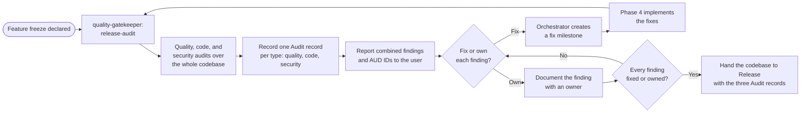

## 5. Audit

Phase 5 runs once per **feature freeze** and audits the **whole frozen codebase**, not a milestone. It is owned by `quality-gatekeeper` and executed through the `release-audit` skill, which combines three audits:

| Audit          | Skill            | Report focus                                                              |
| -------------- | ---------------- | ------------------------------------------------------------------------- |
| Security audit | `security-audit` | Secrets, supply chain, authN/authZ, input handling, data protection, platform and cross-feature risks |
| Quality audit  | `quality-audit`  | Feature completeness against requirements, business rules, acceptance criteria, NFRs, scope, tests |
| Code audit     | `code-audit`     | Complexity, duplication, naming, structure, test coverage, style          |

The audits answer three independent questions:

- **Quality audit** — is every feature implemented properly, against its requirements, business rules, and acceptance criteria?
- **Code audit** — is the code maintainable and evolvable, and does it follow the code guidelines?
- **Security audit** — can the software be exploited?

Each of the three audits is recorded as its own Audit record (`quality`, `code`, `security`), each status `issued`. The user decides per finding whether to fix it or own it. Phase 5 never fixes, versions, packages, deploys, approves, or releases.

Phase position: `Phase 4 → Phase 5 (at feature freeze) → Phase 6 Release`.

### Feature freeze

The freeze is the trigger and the scope of Phase 5.

- The user declares the freeze; it is recorded on the release with its timestamp (with timezone) and the frozen milestone scope.
- The freeze stops the Phase 1–4 loop: no new requests, requirements, scope, or features. Only fixes to findings are allowed while the freeze holds.
- The audit baseline is the commit of the last completed milestone; the release audit covers that committed tree.
- Without a recorded freeze, no release audit runs.
- Keeping or lifting the freeze is a user decision; lifting it returns the work to the Phase 1–4 loop.

### Inputs and preconditions

- **Recorded feature freeze** with the frozen milestone scope.
- **Complete milestones**: every task of every frozen milestone is `Done`, including each milestone's verification task and its standalone code audit.
- **Baseline**: the commit SHA of the last completed milestone.
- **Evidence**: task fulfilment proof, test output, requirements (REQ/NFR), business rules, specifications, decisions, and source code.
- **Audit input**: the whole codebase and test suite at the baseline commit.

Phase 4 verifies each milestone, including a standalone `code-audit` on the milestone's change set. Phase 5 audits the whole frozen codebase independently and reruns the checks rather than trusting the reported evidence.

### Actors

| Actor                | Role in Phase 5                                                                                                              |
| -------------------- | ---------------------------------------------------------------------------------------------------------------------------- |
| `quality-gatekeeper` | Owner: runs `release-audit`, combining the quality, code, and security audits, records one `AUD` per audit, and reports the findings |
| User                 | Declares the freeze and decides for every finding whether it is fixed or owned                                               |
| `orchestrator`       | Receives the report and `AUD` IDs, creates the fix milestone when the user chooses a fix, and records the finding decisions  |
| `*-dev` agents, `task-refiner` | Execute fix work through the fix milestone in Phase 4                                                           |

The release audit is read-only. The gatekeeper never fixes what it finds. It records the three Audit records, each with status `issued`; no approval status is set.

### Flow

### Release audit

- One release audit per freeze: quality, code, and security, each covering the whole frozen codebase.
- The gatekeeper runs each audit with its own skill and combines the findings; it does not weaken or merge distinct checks.
- One Audit record is created per audit type, each status `issued`; the gatekeeper reports the `AUD` IDs with the findings.
- No approval status is set. The user's fix-or-own decisions are recorded by the orchestrator; the Audit records are the evidence.
- Every finding is severity-ranked with evidence, location, and recommendation; the scale is `low`, `medium`, `high`, `blocker`.
- Every finding gets a decision: `fix` or `own`. A finding is never left undecided.
- Findings are rerun or re-read from evidence; a reported result is not accepted on trust.
- The standalone `code-audit` at the end of each milestone is a Phase 4 check and does not replace this whole-codebase code audit.

| Audit          | Verifies                                                                                                                                       |
| -------------- | ---------------------------------------------------------------------------------------------------------------------------------------------- |
| Quality audit  | Requirement and acceptance-criteria coverage, business rules, NFR coverage, scope creep, rerun tests                                            |
| Code audit     | Complexity, duplication, naming, structure, test coverage, code-guideline compliance of the whole codebase and test suite                      |
| Security audit | Secrets, dependency supply chain, authentication and authorization, input handling, data protection, platform risks, cross-feature risks        |

### Audit records

- Three records per release audit: one `quality`, one `code`, one `security`.
- Each record references the release, carries the audit report as its content, and has status `issued`.
- No approval status is set. The user's fix-or-own decisions are recorded by the orchestrator, not as audit approval.
- Only one record of a type may be `issued` in the release scope at a time.
- A rerun after a fix creates new records and archives the previous ones of the same type.

### Finding decisions

The user decides for every finding, and Phase 5 records the decision:

| Decision | Effect                                                                                                                                                                              |
| -------- | ----------------------------------------------------------------------------------------------------------------------------------------------------------------------------------- |
| `fix`    | The finding becomes a fix milestone with its refinement, development, and verification tasks. Phase 4 implements it, then `quality-gatekeeper` reruns the release audit and it passes before Release resumes. |
| `own`    | The finding is documented as an accepted risk with an owner and a follow-up note. It is reported in the release report and does not block the release.                              |

- A finding chosen for fix is not final: after the fix milestone passes Phase 4, the release audit reruns over the whole codebase.
- The fix milestone is scoped only to what the release needs to become releasable; it adds no features and changes no requirement.
- If the user owns a `blocker` finding, Phase 6 records it explicitly; the release approval remains the user's decision.

### Exit criteria

Phase 5 is complete when:

- the freeze is recorded with its frozen scope, and the codebase is audited at its baseline commit;
- the quality, code, and security audits cover the whole codebase;
- every finding has a decision from the user;
- every finding chosen for fix is `Done` through its fix milestone, and the release audit reran and passed;
- every owned finding is documented with an owner and a follow-up note;
- the three Audit records exist with status `issued`;
- the orchestrator holds the finding decisions.

### Boundaries

Phase 5 never:

- fixes or reworks code directly; it creates fix work and returns it to Phase 4;
- changes requirements, acceptance criteria, milestone scope, or the frozen scope;
- lifts or changes the freeze; that is a user decision;
- audits one milestone only, or samples the codebase instead of auditing it whole;
- sets an approval status on an Audit record;
- assigns or changes a version, builds a package, or deploys;
- approves or closes a release; Phase 6 does that;
- writes reports outside the release-audit response and the three Audit records.

### Stop conditions

- No recorded feature freeze: stop; the release audit does not run.
- A frozen milestone has an incomplete task, a failed verification task, or no standalone code audit: return to Phase 4.
- Tests fail or cannot be run: record the failure as a finding; do not accept reported evidence instead.
- An acceptance criterion is ambiguous or unverifiable: stop and report; the criterion is fixed by its owner.
- A finding has no user decision: stop; a finding is never carried without a decision.
- An auditor discovers a requirement gap rather than an implementation defect: the user lifts the freeze and the gap goes through Phase 2.
