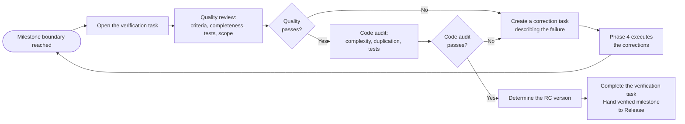

## 5. Verification

Phase 5 independently verifies a **milestone** at its boundary: its acceptance criteria, quality requirements, and code quality. Verification covers only what the milestone changed; the whole release is inspected in Phase 6. It produces the quality and code audits, one verification task, and correction tasks; it never fixes, approves, or releases.

Security is a design concern, handled through requirements and architecture. It is not audited per milestone; security is assessed once at release time, where the combination of features can create risks that no single milestone reveals.

Phase position: `Phase 4 → Phase 5 → Phase 6 Release`.

### Inputs and preconditions

- **Milestone ready for verification**: every execution task is `Done`; the milestone verification task is not yet `Done`.
- **Evidence from implementation**: task fulfilment proof and test output.
- **Milestone acceptance criteria**, plus referenced requirements (REQ/NFR) and specifications.
- **Change set**: the code, tests, configuration, and behavior the milestone changed.

Phase 4 does not verify the increment. Phase 5 runs the milestone verification task independently and reruns the checks rather than trusting the reported evidence.

### Actors

| Actor                  | Role in Phase 5                                                                                               |
| ---------------------- | ------------------------------------------------------------------------------------------------------------- |
| `quality-gatekeeper`   | Milestone quality review: acceptance criteria, required-field completeness, rerun tests, scope creep, NFR coverage |
| `code-analyzer`        | Audits the code and tests changed in the milestone and records an Audit artifact (type: code)                 |
| `orchestrator`         | Opens and runs the verification task, creates correction tasks, determines the RC version, records the result |
| `planner`              | Creates the milestone verification task during planning, and follow-up work for accepted findings              |
| User                   | Approves each audit finding or requests correction; release approval belongs to Phase 6                       |

Reviewers are independent of implementation and read-only. A reviewer never fixes what it finds.

### Flow

### Verification task

- The planner creates **one milestone verification task per milestone**; the orchestrator opens it when the milestone's execution tasks are `Done`. The criteria are on the milestone. No other verification reports are written.
- The task is not `Done` until every check passes; the milestone is not complete before that.
- The task records: milestone and change set, checks run, evidence, findings, the audits, the correction tasks it created, the RC version, and the final result.
- A failed quality review or code audit creates a **correction task** in the milestone being verified with the failure description and the acceptance criteria it blocks. Correction tasks stay inside the milestone's approved scope and are created by the orchestrator to complete the unfulfilled scope; they do not change the scope. Scope, dependency, or ordinal changes, if ever required, go to the planner.
- Correction tasks follow the Phase 4 task model: assigned to an owning actor, executed, and `Done` only when their criteria are met.
- The verification task is not `Done` until every correction task is `Done` and verification is rerun and passes.

### Checks

Checks are change-scoped: they inspect the milestone's change set and the behavior it touches, not the whole corpus. All results are recorded in the verification task.

| Check          | Verifies                                                                                                                                             | Result                   |
| -------------- | ---------------------------------------------------------------------------------------------------------------------------------------------------- | ------------------------ |
| Quality review | Each milestone acceptance criterion, required-field completeness, rerun tests, scope creep, referenced NFRs                                          | Audit (type: quality); pass or correction tasks |
| Code audit     | Complexity, duplication, naming, structure, test coverage, style-guide compliance of code and tests created or modified in the milestone          | Audit (type: code); pass or correction tasks    |

Rules:

- Every check reruns or re-reads its evidence; reported results are not accepted on trust.
- Findings are severity-ranked with evidence, location, and recommendation; the scale is `low`, `medium`, `high`, `blocker`.
- Accepted findings require an owner and a follow-up task.
- The code audit targets only the code and tests created or modified in the milestone; pre-existing code is not audited here.
- Unchanged areas are not re-audited; they are covered by the release-wide inspection in Phase 6.

Audits follow their own lifecycle: `issued → approved → archived`. A finding the user does not approve becomes a correction task; after the correction a new audit is issued and the old one is archived. Only one audit of a type can be `issued` or `approved` within a single assessed scope (one milestone in Phase 5, one release in Phase 6) at a time; when a check is rerun after a correction, the new audit replaces the previous one, which is `archived`.

### Versioning (release candidate)

- Each verified milestone receives an RC version, derived from the changes it contains.
- The RC version is recorded in the verification task and becomes an input to the release.
- RC numbering restarts when the major version increments. RC versions are Semantic Versioning pre-release identifiers (e.g. `1.2.0-rc.1`).
- The final release version is chosen in Phase 6, not here.

### Failure handling

| Outcome                  | Action                                                                                           |
| ------------------------ | ------------------------------------------------------------------------------------------------ |
| Quality review fails     | Create correction tasks with the failure description; Phase 4 executes them; verification reruns |
| Code audit finds defects | Create correction tasks with the failure description; Phase 4 executes them; verification reruns |
| Accepted finding         | Planning creates follow-up work; the milestone proceeds with the risk documented                 |
| Scope creep              | Report the unjustified change; the user decides removal or a requirements change through Phase 2 |

Verification never silently lowers a criterion or accepts a failure. It records the failure and returns the work.

### Exit criteria

Phase 5 is complete when:

- the milestone scope is complete and all its execution tasks are `Done`;
- the whole change set of the milestone is covered by the checks;
- every correction task created by a failed check is `Done`;
- verification ran again after the corrections and passed;
- accepted findings have an owner and a follow-up task;
- the verification task is `Done` with the RC version and the milestone verification result; the quality audit and the code audit are recorded as Audit artifacts (types: quality, code) and approved by the user.

### Boundaries

Phase 5 never:

- fixes or reworks code directly; it creates correction tasks and returns the work;
- changes requirements, acceptance criteria, milestone scope, dependencies, or ordinals; corrections stay within the approved scope and follow the planner's rules;
- verifies more than one milestone in a pass;
- approves or closes a release; Phase 6 does that;
- inspects unchanged areas or the whole release; Phase 6 does the full release inspection;
- runs the release review, release quality, code, or security audit, or final release tests; those belong to Phase 6;
- verifies around an incomplete task;
- writes reports outside the verification task and the audit artifact.

### Stop conditions

- A task in the milestone is not `Done`: return to Phase 4.
- Tests fail or cannot be run: record the failure and create correction tasks; do not accept reported evidence instead.
- An acceptance criterion is ambiguous or unverifiable: stop and report; the criterion is fixed by its owner.
- Unresolved finding without an owner: stop; a finding is never carried without an owner.
- A reviewer discovers a requirement gap rather than an implementation defect: return to Phase 2.

### Open points

- Whether the code audit is mandatory for every milestone or proportional to the change size is not yet fixed.
- How the change set is delimited for a milestone is not yet fixed.
