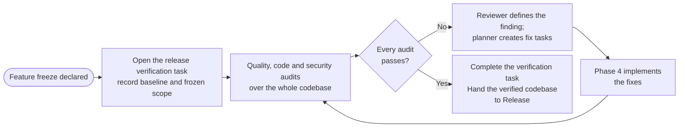

## 5. Verification

Phase 5 runs once per **feature freeze** and verifies the **whole codebase**, not a milestone. It answers three questions independently:

- **Quality audit** — is every feature implemented properly, against its requirements, business rules, and acceptance criteria?
- **Code audit** — is the code maintainable and evolvable, and does it follow the code guidelines?
- **Security audit** — can the software be exploited?

Verification produces the three audits and one release verification task, and turns failures into fix tasks. It never fixes, versions, packages, approves, or releases.

Phase position: `Phase 4 → Phase 5 (at feature freeze) → Phase 6 Release`.

### Feature freeze

The freeze is the trigger and the scope of Phase 5.

- The user declares the freeze; it is recorded on the release with its timestamp (with timezone) and the frozen milestone scope.
- The freeze stops the Phase 1–4 loop: no new requests, requirements, scope, or features. Only fixes to verification findings are allowed while the freeze holds.
- The verification baseline is the RC version and commit of the last completed milestone; verification audits that committed tree.
- Without a recorded freeze, no verification runs.
- Keeping or lifting the freeze is a user decision; lifting it returns the work to the Phase 1–4 loop.

### Inputs and preconditions

- **Recorded feature freeze** with the frozen milestone scope.
- **Complete milestones**: every task of every frozen milestone is `Done`, and each milestone has its RC version and its packaged RC under `builds/<version>/`, or a recorded packaging waiver.
- **Baseline**: the RC version and commit SHA of the last completed milestone.
- **Evidence**: task fulfilment proof, test output, requirements (REQ/NFR), business rules, specifications, architecture, and decisions.
- **Audit input**: the whole codebase and test suite at the baseline commit.

Phase 4 does not verify the increment. Phase 5 audits the frozen codebase independently and reruns the checks rather than trusting the reported evidence.

### Actors

| Actor                | Role in Phase 5                                                                                                                    |
| -------------------- | ---------------------------------------------------------------------------------------------------------------------------------- |
| `quality-gatekeeper` | Runs the quality audit: every feature implemented properly, acceptance-criteria and requirement coverage, NFRs, scope creep, rerun tests |
| `code-analyzer`      | Runs the code audit over the whole codebase: maintainability, evolvability, code-guideline compliance, tests                        |
| `security-officer`   | Runs the security audit over the whole codebase: exploitability, attack surface, cross-feature risks                               |
| `orchestrator`       | Opens and closes the release verification task, records the baseline, the audits, findings, fix tasks, and the result                   |
| `planner`            | Creates fix tasks in the fix milestone at the reviewers' request, and follow-up tasks for accepted findings                        |
| User                 | Declares the freeze, and accepts or rejects each finding at the Phase 6 scope-and-findings review; no approval happens in this phase |

Reviewers are independent of implementation and read-only. A reviewer never fixes what it finds.

### Flow

### Release verification task

- The planner creates **one release verification task** when the freeze is declared; the orchestrator opens it and closes it when every audit passes. It belongs to the release, not to a milestone.
- It records: freeze (timestamp and frozen scope), baseline RC version and commit SHA, audits run, evidence, findings, the fix tasks it created, and the final result.
- Each rerun after a fix records the new baseline (the fix milestone's RC version and commit).
- It is not `Done` until all three audits pass, every fix task is `Done`, and the audits were rerun and passed.
- No other verification reports are written.

### Checks

All checks cover the frozen codebase, including code unchanged since the last release. All results are recorded in the release verification task.

| Audit           | Question                                                                    | Verifies                                                                                                                                       | Result                    |
| --------------- | --------------------------------------------------------------------------- | ---------------------------------------------------------------------------------------------------------------------------------------------- | ------------------------- |
| Quality audit   | Is every feature implemented properly?                                      | Requirement and milestone acceptance-criteria coverage, business rules, NFR coverage, scope creep, rerun tests                                  | Audit (type: quality)     |
| Code audit      | Is the code maintainable and evolvable, does it follow the code guidelines?  | Complexity, duplication, naming, structure, test coverage, code-guideline compliance of the whole codebase and test suite                      | Audit (type: code)        |
| Security audit  | Can the software be exploited?                                              | Secrets, dependency supply chain, authentication and authorization, input handling, data protection, platform risks, cross-feature risks        | Audit (type: security)    |

Rules:

- Every audit reruns or re-reads its evidence; reported results are not accepted on trust.
- Findings are severity-ranked with evidence, location, and recommendation; the scale is `low`, `medium`, `high`, `blocker`.
- Every finding gets an owner; a finding the user does not accept becomes fix work, an accepted finding gets a follow-up task.
- The audits are read-only.
- The code audit and the security audit cover the whole codebase, not only the latest milestone's changes.

Audits follow their own lifecycle: `issued → approved → archived`; `approved` records the user's acceptance of the findings at the Phase 6 scope-and-findings review, so a Phase 5 audit stays `issued` until then. Only one audit of a type can be `issued` or `approved` within the release scope at a time; when an audit is rerun after a fix, the new audit replaces the previous one, which is `archived`.

### Failure handling

| Outcome                             | Action                                                                                                     |
| ----------------------------------- | ---------------------------------------------------------------------------------------------------------- |
| A feature is not implemented properly | Create fix tasks with the failure description; Phase 4 executes them; the audits rerun                     |
| Code-guideline or maintainability finding | Create fix tasks; Phase 4 executes them; the code audit reruns                                        |
| Security finding                    | Create fix tasks for rejected findings; accepted findings are recorded with an owner and follow-up at the Phase 6 review |
| Audit cannot run or lacks evidence  | Stop and report; the missing input is supplied before verification continues                              |
| Accepted finding                    | Record it with an owner and a follow-up task; the finding is reviewed at the Phase 6 gate                  |
| Scope creep                         | Report the unjustified change; the user decides removal or lifts the freeze through Phase 2                |

Verification never silently lowers a criterion or accepts a failure. It records the failure and returns the work.

### Exit criteria

Phase 5 is complete when:

- the freeze is recorded with its frozen scope, and the codebase is verified at its baseline commit;
- all three audits cover the whole codebase;
- the quality audit, code audit, and security audit pass;
- every fix task created by a failed audit is `Done`;
- the audits ran again after the fixes and passed;
- accepted findings have an owner and a follow-up task;
- the release verification task is `Done` with the audit results and the verification result; the audits are recorded as Audit artifacts (types: quality, code, security) with status `issued`, to be reviewed by the user at the Phase 6 gate.

### Boundaries

Phase 5 never:

- fixes or reworks code directly; it creates fix tasks and returns the work;
- changes requirements, acceptance criteria, milestone scope, or the frozen scope; findings become fix work only;
- lifts or changes the freeze; that is a user decision;
- verifies one milestone only, or samples the codebase instead of auditing it whole;
- assigns or changes a version, or builds a package; RC and final builds belong to Phases 4 and 6;
- approves or closes a release; Phase 6 does that;
- writes reports outside the release verification task and the audit artifacts.

### Stop conditions

- No recorded feature freeze: stop; verification does not run.
- A frozen milestone has an incomplete task or no RC package: return to Phase 4.
- Tests fail or cannot be run: record the failure and create fix tasks; do not accept reported evidence instead.
- An acceptance criterion is ambiguous or unverifiable: stop and report; the criterion is fixed by its owner.
- A finding has no owner: stop; a finding is never carried without an owner.
- A reviewer discovers a requirement gap rather than an implementation defect: the user lifts the freeze and the gap goes through Phase 2.
