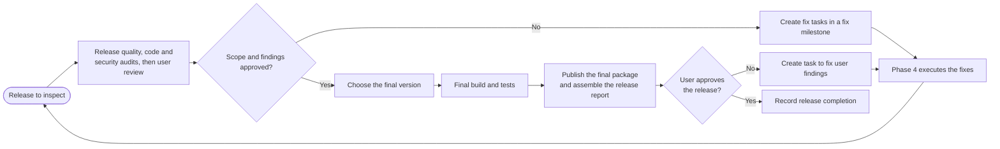

## 6. Release

Phase 6 inspects the **whole release** — not one single milestone — runs the audits, obtains the user's approval of the scope and the audit findings, then runs the final build and tests on that approved scope, publishes the final-version package, assembles the release report, requests explicit release approval, and records completion.

Phase position: `Phase 5 → Phase 6`. Phase 5 verifies milestones change-scoped; Phase 6 verifies the release as a whole and is the only phase that approves or closes it.

### Inputs and preconditions

- **Verified milestones**: every milestone in scope is complete and carries a Phase 5 verification result.
- **Verification evidence**: closed milestone verification tasks, their corrections, accepted risks, and follow-up work.
- **All included changes**: requirements, specifications, UI, code, tests, and configuration delivered by the release.

Release work does not start while a milestone is incomplete or unverified.

### Actors

| Actor                | Role in Phase 6                                                                                                                                                                       |
| -------------------- | ------------------------------------------------------------------------------------------------------------------------------------------------------------------------------------- |
| `orchestrator`       | Owner: chooses the final version, runs the release process, aggregates evidence, publishes the final package with `packaging`, compiles the report, records completion after approval |
| `quality-gatekeeper` | Release quality audit and final test results over the whole release                                                                                                                   |
| `code-analyzer`      | Release-wide code audit of the whole codebase and test suite, including code unchanged in this release                                                                                |
| `security-officer`   | Reports security findings with severity and a recommendation; does not decide acceptance                                                                                              |
| `planner`            | Keeps the release composition and milestone assignment accurate; the version is determined in this phase                                                                              |
| User                 | Approves the release scope and the audit findings, decides whether each security finding is acceptable, gives the explicit release approval, and may waive packaging for the release  |
| Task owners          | Execute fix tasks in the fix milestone and rework work returned to their milestones                                                                                                   |

### Flow

### Phase boundary with Verification

| Concern  | Phase 5 Verification                                              | Phase 6 Release                                                                               |
| -------- | ----------------------------------------------------------------- | --------------------------------------------------------------------------------------------- |
| Scope    | One milestone at its boundary                                     | The whole release, all its milestones                                                         |
| Depth    | Change set of the milestone                                       | Full change set plus integration and regression                                               |
| Checks   | Quality review and code audit, change-scoped                      | Release quality audit, release-wide code audit, release security audit, final build and tests |
| Security | Not assessed here; security is by design                          | Assessed only here, across the whole release and its feature combinations                     |
| Output   | Per-milestone evidence, the RC version, and its published package | Release report, final package, and a release decision                                         |
| Approval | None                                                              | Scope and audit findings, then release                                                        |
| Failure  | Reopens tasks in that milestone                                   | Returns the release work to the owning milestone                                              |

Phase 6 does not repeat the per-milestone checks. It inspects what only the whole release can reveal: integration between milestones, cumulative change, regression, release-wide consistency, and security risks created by combining features.

### Release definition

- A release is a version record, open until completed, owning one or more verified milestones; milestones can be added while it is `open`.
- the **final** version is chosen at the end, after the scope and the audit findings are approved and immediately before the final build. It is derived from all included changes and the RC versions of the verified milestones. RC versioning already happened in Phase 5; no version is assigned during planning. Versions follow Semantic Versioning (MAJOR.MINOR.PATCH); milestone candidates are recorded as RC pre-release versions (e.g. `1.2.0-rc.1`) and are not published.
- The version is recorded on the release before the final build and becomes the version of the release report.
- The release has no acceptance criteria of its own; project-wide criteria apply.

### Release inspection

| Check                 | Covers                                                                                                                    | Output                                                                    |
| --------------------- | ------------------------------------------------------------------------------------------------------------------------- | ------------------------------------------------------------------------- |
| Release quality audit | Milestones complete and verified, whole change set, consistency across milestones, integration, scope creep, NFR coverage | Audit (type: quality) with severity-ranked findings                       |
| Release code audit    | The whole codebase and test suite, including code not changed in this release                                             | Audit (type: code) with severity-ranked findings                          |
| Security audit        | The whole release, cross-feature risks, and risks created by combining features                                           | Audit (type: security) with severity-ranked findings and a recommendation |
| Final build and tests | The approved release as built, full suite, regression                                                                     | Pass/fail with evidence                                                   |

Rules:

- The whole release is inspected; no milestone is taken on trust.
- Every audit is recorded as an Audit artifact with its type (`quality`, `code`, `security`); see [artifacts.md](./artifacts.md).
- Findings are severity-ranked with evidence and an owner.
- Security findings are reported to the user, who decides acceptance.
- The user approves the release scope and the audit findings before the final build runs.
- A finding the user does not accept becomes a fix task in the fix milestone.
- An accepted finding is documented in the audit of its type with an owner and a follow-up task.
- The release cannot be completed while a finding is neither accepted nor fixed.
- The audits are read-only; fixes become tasks in the release's fix milestone.
- The final build validates the approved scope; it never builds a scope the user has not approved.

### Final package

The release itself is packaged here, at the end of Phase 6, after the final build and tests pass and the final version is recorded. The orchestrator publishes it with `packaging`, in the same way as each milestone's RC package in Phase 5.

- Each deployable component is built by its own `<component-dir>/scripts/build-package.sh`, which is created and owned by the `*-dev` agent of that technology inside its component folder (`apps/<app>` in a multi-app repository, or the repository root for a single-app project). Packaging never uses ad-hoc build commands.
- Built from the committed release tree; the commit SHA is recorded.
- Written to the git-ignored `builds/<version>/` with one archive per deployable component, `MANIFEST.txt`, and a `.sha256` per archive.
- Local only: nothing is staged, committed, tagged, pushed, uploaded, or deployed.
- The final version directory is immutable; a failed or superseded attempt needs the release version decision to be revisited, not an overwrite.
- The package paths, sizes, checksums, build script paths, and commit SHA go into the release report and the completion note.
- Milestone RC packages are not reused as the release package; the release is built and packaged under its final version.

When a component has no build script, packaging stops and the missing script becomes a fix task in the release's fix milestone, owned by the technology's `*-dev` agent. The user may waive packaging for the release; a waiver is explicit, user-only, and recorded in the release report with its scope, reason, and timestamp (with timezone).

### Fix milestone

When a release audit fails, the user rejects a finding or the approved scope, or the final tests fail, the findings become fix work.

- The planner creates the fix tasks and attaches them to the release's fix milestone, creating that milestone if it does not exist; the auditor who reported each finding defines the fix task's content.
- The fix milestone contains only the fix work needed for the release to be releasable; no new features, no scope expansion.
- It is executed and verified like any milestone: Phase 4 runs the tasks, Phase 5 verifies the milestone.
- The release inspection and the scope-and-findings approval are rerun after the fix milestone is verified.
- The release cannot be completed while a fix task is open or the fix milestone is unfinished.
- Security findings the user rejects are fixed the same way; accepted findings are documented in the audit instead.

### Release report

The report contains:

- version, release scope, and owned milestones;
- implemented requests;
- change log;
- completed tasks and their requirements traceability;
- final test results;
- package evidence: final version, commit SHA, component archives, paths, sizes, and sha256, or the recorded packaging waiver;
- per-milestone verification, and audit severity counts by type;
- accepted risks with owners and follow-ups;
- fix milestone and its fix tasks, if any;
- findings, exclusions, and open questions;
- the recommendation: ready for approval or not.

### Approval and completion

Phase 6 has two approvals:

| Approval                 | When                                                                         | Effect                                                      |
| ------------------------ | ---------------------------------------------------------------------------- | ----------------------------------------------------------- |
| Scope and audit findings | After the release quality, code, and security audits, before the final build | Confirms the release scope, accepts or rejects each finding |
| Release                  | After the final build and tests, on the assembled release report             | Completes or withholds the release                          |

- The user approves or withholds each approval explicitly.
- The final build and tests run only after the scope and audit findings are approved.
- The final version is chosen between the scope approval and the final build; no build runs on an unversioned release.
- A withheld scope approval returns the work to the owning milestones or the fix milestone; no build runs.
- A withheld release approval returns the work to the owning milestones or the fix milestone; nothing is recorded as released.
- On release approval, the release record is marked complete with its version and completion note, and the release report becomes the release evidence.
- Local package publication is part of this workflow; version tags, remote uploads, and deployments are outside it unless the user asks for them.

### Failure handling

| Outcome                                              | Action                                                                                                               |
| ---------------------------------------------------- | -------------------------------------------------------------------------------------------------------------------- |
| A milestone is incomplete or unverified              | Return to Phase 4 or 5; no release inspection                                                                        |
| A release audit fails                                | Create fix tasks in the fix milestone; Phase 4 executes; Phase 5 verifies; the release inspection reruns             |
| Security findings not accepted                       | Create fix tasks in the fix milestone; the release cannot complete while they remain                                 |
| Security findings accepted                           | Document each accepted finding with an owner and follow-up in the security audit; the release proceeds               |
| Scope or findings not approved                       | Create fix tasks in the fix milestone; no final build runs                                                           |
| Final build or tests fail                            | Create fix tasks in the fix milestone; the inspection, the approval, and the build are rerun after they are verified |
| Final package build fails                            | Create fix tasks in the fix milestone; the release is not completed and nothing is published                         |
| A deployable component has no build script           | Create a fix task in the fix milestone for the owning `*-dev` agent; packaging resumes after it is verified          |
| Final package directory exists or is not git-ignored | Stop; the user decides the version and the ignore rules; an existing version is never overwritten                    |
| Release approval withheld                            | Return the work to the owning milestones or the fix milestone; report the reason                                     |
| Scope creep found                                    | User decides removal or a requirements change through Phase 2                                                        |

### Exit criteria

Phase 6 is complete when:

- every release milestone is complete and verified;
- the whole release passed the release quality, code, and security audits;
- the user approved the release scope and the audit findings;
- the final version is chosen and recorded on the release;
- the final build and tests ran after that approval and passed;
- the final package is published for the recorded version under the git-ignored `builds/<version>/`, its checksums verified, and its evidence recorded in the release report; nothing of it is staged, committed, tagged, pushed, or uploaded, or the user explicitly waived packaging and the waiver is recorded;
- every security finding is either accepted by the user and documented, or fixed with the fix milestone finished;
- every fix task is `Done` and the fix milestone is finished (all tasks `Done`, verification passed);
- accepted risks and follow-ups are documented with owners;
- the release report is complete;
- the user approved the release and the release record is marked complete.

### Boundaries

Phase 6 never:

- fixes, reworks, or verifies a single milestone again;
- changes requirements, criteria, scope, or the plan;
- approves on the user's behalf;
- records completion while a fix task is open or the fix milestone is unfinished;
- records completion without a full release inspection and explicit approval;
- runs the final build before the scope and audit findings are approved;
- overwrites or rebuilds an existing package version;
- commits, tags, pushes, uploads, or deploys a package; publication is local to `builds/<version>/` only;
- tags, uploads, or deploys unless the user explicitly asks.

### Stop conditions

- A milestone in scope is incomplete or unverified: stop; the release is not inspected until it is complete and verified.
- The release has no acceptance criteria of its own: project-wide criteria apply.
- A release audit fails: create fix tasks in the fix milestone; no final build runs.
- The user does not approve the scope or the audit findings: create fix tasks in the fix milestone; no final build runs.
- Final build or tests fail: create fix tasks in the fix milestone; the release is not completed.
- The final package fails to build: create fix tasks; nothing is published and the release is not completed.
- A security finding is neither accepted nor fixed: the release cannot be completed.
- Missing evidence for a project-wide criterion: stop; the owning milestone supplies it.
- Release approval withheld: stop and report.

### Open points

- Who approves a release when several stakeholders are involved is not yet fixed.
- Resolved: versioning follows Semantic Versioning (MAJOR.MINOR.PATCH, with RC pre-release identifiers for milestone candidates); see the release definition above.
