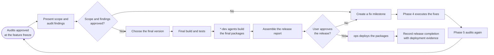

## 6. Release

Phase 6 turns a **passed audit at the feature freeze** into a published release: it obtains the user's approval of the scope and the audit findings, chooses the final version, runs the final build and tests, has the `*-dev` agents build the final release packages, assembles the release report, requests explicit release approval, deploys the packages through the `ops` agent, and records completion.

Phase position: `Phase 5 → Phase 6`. Phase 5 audits the frozen codebase; Phase 6 is the only phase that approves, deploys, or closes a release. Phase 6 does not audit again: it relies on the Phase 5 security, quality, and code audits.

### Inputs and preconditions

- **Passed audit**: the security, quality, and code audits are `approved`; every finding is fixed or owned.
- **Feature freeze**: recorded with its frozen milestone scope and timestamp (with timezone).
- **Complete milestones**: every frozen milestone has its verification task `Done`.
- **All included changes**: requirements, specifications, UI, code, tests, and configuration delivered by the release.
- **Owned findings and follow-ups**, with owners.

Release work does not start while the freeze is missing, a frozen milestone is incomplete, a milestone verification has not passed, or an audit finding has no decision.

### Actors

| Actor          | Role in Phase 6                                                                                                                                                          |
| -------------- | ------------------------------------------------------------------------------------------------------------------------------------------------------------------------ |
| `orchestrator` | Owner: chooses the final version, runs the release process, runs the final build and tests, verifies the packages, compiles the report, records completion                 |
| `*-dev` agents | Build the final release packages of their components under the chosen version                                                                                            |
| `ops`          | Deploys the final packages to the release target environment(s) and reports deployment evidence                                                                          |
| User           | Approves the release scope and the findings, gives the explicit release approval, and may waive packaging or deployment                                                  |
| Task owners    | Execute fix tasks in the fix milestone                                                                                                                                   |

### Flow

### Phase boundary with Audit

| Concern  | Phase 5 Audit                                                        | Phase 6 Release                                                          |
| -------- | -------------------------------------------------------------------- | ------------------------------------------------------------------------ |
| Trigger  | The user's feature freeze                                            | Audits approved                                                          |
| Scope    | The whole codebase at the frozen baseline                            | The frozen release scope as approved by the user                         |
| Checks   | Security, quality, and code audits                                   | Final build and tests on the approved scope; no new audits               |
| Output   | The three audits and the finding decisions                           | Release report, final packages, deployment, completed release            |
| Approval | The user's decision per finding                                      | Scope and findings, then the release itself                              |
| Failure  | Fix milestone; Phase 4 implements, Phase 5 audits again              | Fix milestone; Phase 4 implements, Phase 5 audits again                  |

Phase 6 never repeats the Phase 5 audits itself. Outside the fix-milestone loop, it confirms that the audits passed, that the audited baseline is the code being released, and that every finding is fixed or owned.

### Release definition

- A release is a version record, open until completed, owning one or more milestones; milestones can be added while it is `open`.
- The feature freeze closes its scope. After the freeze only fix work may enter the release.
- The **final** version is chosen at the end, after the scope and the audit findings are approved and immediately before the final build. It is derived from all included changes. Versions follow Semantic Versioning (MAJOR.MINOR.PATCH). There are no RC versions.
- The final version is recorded on the release before the final build and becomes the version of the release report.
- The release has no acceptance criteria of its own; project-wide criteria apply.

### Scope and findings gate

The audit findings come from Phase 5; Phase 6 presents them and the release scope to the user.

- The user approves or withholds the release scope and the audit findings; this is the first of the two Phase 6 approvals.
- Presentation includes the three audits, their severity-ranked findings, the owned risks with owners and follow-ups, the frozen milestone scope, and the closed fix milestones.
- A finding is already decided as `fix` or `own` in Phase 5. Here the user confirms the scope including those decisions.
- A rejected scope or finding returns the work to a fix milestone; no final build runs.
- No finding may enter the final build while it is neither fixed nor owned.

### Final build and tests

- Runs only after the scope and findings are approved and the final version is recorded.
- Builds the approved release scope from the committed tree and records the commit SHA.
- Runs the full test suite, including regression and integration across milestones; the orchestrator records the results.
- The final build validates the approved scope; it never builds a scope the user has not approved.
- A failed final build or test becomes a fix task in the fix milestone; the release is not completed.

### Final package

The release is packaged after the final build and tests pass and the final version is recorded.

- Each `*-dev` agent builds the final package of its own component with that component's `<component-dir>/scripts/build-package.sh`, inside its component folder (`apps/<app>` in a multi-app repository, or the repository root for a single-app project). Packaging never uses ad-hoc build commands.
- All system elements are packaged under the one final version; they share that version.
- Packages are built from the committed release tree; the commit SHA is recorded.
- Written to the git-ignored `builds/<version>/` with one archive per system element, `MANIFEST.txt`, and a `.sha256` per archive.
- The orchestrator verifies the package paths, sizes, checksums, and build script paths, and records them.
- The final version directory is immutable; a failed or superseded attempt needs the release version decision to be revisited, not an overwrite.
- Package output is local: it is never staged, committed, tagged, pushed, or uploaded.

When a component has no build script, packaging stops and the missing script becomes a fix task in the release's fix milestone, owned by the technology's `*-dev` agent. The user may waive packaging for the release; a waiver is explicit, user-only, and recorded in the release report with its scope, reason, and timestamp (with timezone).

### Deployment

- The `ops` agent deploys the final packages after the user approves the release.
- Deployment targets, environments, and procedure are project-specific; the release record names the target of each deployment.
- The deployment uses the built packages under `builds/<version>/`; the deployed version is the final version of the release.
- The `ops` agent reports the deployment evidence: version, commit SHA, target environment(s), result, and timestamp (with timezone).
- A failed deployment becomes a fix task in the fix milestone; the release is not completed until the deployment succeeds.
- The user may waive deployment for the release; the waiver is explicit, user-only, and recorded in the release report with its scope, reason, and timestamp (with timezone).
- Deployment is the only point in the workflow that changes a live environment.

### Fix milestone

When an audit finding is chosen for fix, the user rejects the scope, or the final build, packaging, or deployment fails, the findings become fix work.

- The orchestrator creates the fix milestone with its refinement, development, and verification tasks, and attaches it to the release.
- The audit or review that reported each finding defines the fix task's content.
- The fix milestone contains only the fix work needed for the release to be releasable; no new features, no scope expansion.
- It is executed like any milestone: Phase 4 runs refinement, development, and verification, then Phase 5 reruns the audits over the whole codebase.
- The scope-and-findings gate, the final build, the packages, and the deployment are rerun after the audits pass.
- The release cannot be completed while a fix task is open or the fix milestone is unfinished.
- Findings the user owns are documented in the audit instead and reported in the release report.

### Release report

The report contains:

- version, release scope, owned milestones, and the feature freeze (timestamp with timezone);
- implemented requests;
- change log;
- completed tasks and their requirements traceability;
- final test results;
- package evidence: final version, commit SHA, component archives, paths, sizes, and sha256, or the recorded packaging waiver;
- deployment evidence: version, targets, result, and timestamp (with timezone), or the recorded deployment waiver;
- the audit results, the finding decisions, and severity counts by type;
- owned risks with owners and follow-ups;
- fix milestones and their fix tasks, if any;
- findings, exclusions, and open questions;
- the recommendation: ready for approval or not.

The report is assembled before the release approval with every piece of evidence except deployment. The deployment evidence is added after the `ops` agent deploys and before completion is recorded.

### Approval and completion

Phase 6 has two approvals:

| Approval                 | When                                                                             | Effect                                                      |
| ------------------------ | -------------------------------------------------------------------------------- | ----------------------------------------------------------- |
| Scope and audit findings | After the Phase 5 audits are presented, before the final build                   | Confirms the release scope and the finding decisions        |
| Release                  | After the final build and tests and the assembled release report                 | Authorizes deployment; completion follows the successful deployment |

- The user approves or withholds each approval explicitly.
- The final build and tests run only after the scope and audit findings are approved.
- The final version is chosen between the scope approval and the final build; no build runs on an unversioned release.
- A withheld scope approval returns the work to the fix milestone; no build runs.
- A withheld release approval returns the work to the fix milestone; nothing is deployed.
- After release approval, the `ops` agent deploys; on a successful deployment the release record is marked complete with its version, package evidence, deployment evidence, and completion note, and the release report becomes the release evidence.
- Completion is recorded only after a successful deployment or a recorded deployment waiver.

### Failure handling

| Outcome                                              | Action                                                                                                               |
| ---------------------------------------------------- | -------------------------------------------------------------------------------------------------------------------- |
| Audits not approved or a finding undecided           | Return to Phase 5; no release work starts                                                                            |
| Scope or findings not approved                       | Create a fix milestone; Phase 4 and Phase 5 run; the gate reruns                                                     |
| Final build or tests fail                            | Create a fix milestone; Phase 4 and Phase 5 run; the gate and the build are rerun                                     |
| A component has no build script                      | Create a fix task in the fix milestone for the owning `*-dev` agent; packaging resumes after verification             |
| Final package build fails                            | Create a fix task in the fix milestone; the release is not completed and nothing is deployed                         |
| Final package directory exists or is not git-ignored | Stop; the user decides the version and the ignore rules; an existing version is never overwritten                     |
| Deployment fails                                     | Create a fix task in the fix milestone; the release is not completed and the deployment is retried after the fix     |
| Release approval withheld                            | Return the work to the fix milestone; report the reason                                                              |
| Scope creep found                                    | User decides removal or lifts the freeze and routes the change through Phase 1 and Phase 2                            |

### Exit criteria

Phase 6 is complete when:

- the feature freeze is recorded, every frozen milestone's verification task is `Done`, and the three audits are approved;
- every finding is either owned and documented, or fixed through a verified fix milestone and audited again;
- the user approved the release scope and the audit findings;
- the final version is chosen and recorded on the release;
- the final build and tests ran after that approval and passed;
- each `*-dev` agent built the final package of its component under the final version, and the package evidence is recorded, or the user explicitly waived packaging and the waiver is recorded;
- the final packages are published locally under the git-ignored `builds/<version>/`, with checksums verified, or the packaging waiver is recorded;
- the `ops` agent deployed the final version to the release target(s) and the deployment evidence is recorded, or the deployment waiver is recorded;
- the release report is complete;
- the user approved the release and the release record is marked complete.

### Boundaries

Phase 6 never:

- reruns the Phase 5 audits outside the fix-milestone loop;
- verifies a milestone again outside the fix-milestone loop;
- changes requirements, criteria, or the frozen scope;
- approves on the user's behalf;
- records completion while a fix task is open, the fix milestone is unfinished, or the deployment failed without a waiver;
- records completion without a passed audit and explicit approval;
- runs the final build before the scope and audit findings are approved;
- overwrites or rebuilds an existing package version;
- performs the deployment itself; deployment belongs to the `ops` agent;
- stages, commits, tags, pushes, or uploads a package.

### Stop conditions

- The feature freeze is missing or a frozen milestone is incomplete: stop; the release does not start.
- The audit has not passed: stop; the release is not inspected until it has.
- The user does not approve the scope or the findings: create a fix milestone; no final build runs.
- Final build or tests fail: create a fix milestone; the release is not completed.
- The final package fails to build: create a fix task; nothing is deployed and the release is not completed.
- Deployment fails: create a fix task; the release is not completed.
- A finding is neither fixed nor owned: the release cannot be completed.
- Missing evidence for a project-wide criterion: stop; the owning milestone supplies it.
- Release approval withheld: stop and report.

### Open points

- Who approves a release when several stakeholders are involved is not yet fixed.
- Deployment targets and rollback policy are project-specific and not yet part of the workflow definition.
