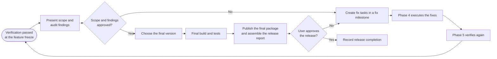

## 6. Release

Phase 6 turns a **passed verification at the feature freeze** into a published release: it obtains the user's approval of the scope and the audit findings, chooses the final version, runs the final build and tests, publishes the final-version package, assembles the release report, requests explicit release approval, and records completion.

Phase position: `Phase 5 → Phase 6`. Phase 5 audits the frozen codebase; Phase 6 is the only phase that approves or closes a release. Phase 6 does not audit again: it relies on the Phase 5 quality, code, and security audits.

### Inputs and preconditions

- **Passed verification**: the release verification task is `Done`; the quality, code, and security audits passed and are `issued`.
- **Feature freeze**: recorded with its frozen milestone scope and timestamp (with timezone).
- **Milestone RC versions and packages**: every frozen milestone carries its RC version; its RC package is under `builds/<version>/` or explicitly waived.
- **All included changes**: requirements, specifications, UI, code, tests, and configuration delivered by the release.
- **Accepted findings and follow-ups**, with owners.

Release work does not start while the freeze is missing, a frozen milestone is incomplete, or verification has not passed.

### Actors

| Actor                | Role in Phase 6                                                                                                                                                                       |
| -------------------- | -------------------------------------------------------------------------------------------------------------------------------------------------------------------------------------- |
| `orchestrator`       | Owner: chooses the final version, runs the release process, aggregates evidence, publishes the final package with `packaging`, compiles the report, records completion after approval |
| `quality-gatekeeper` | Confirms the final test run and the test evidence against the audited baseline                                                                                                        |
| `planner`            | Creates fix tasks in the fix milestone; keeps the release composition accurate; does not choose the version                                                                           |
| User                 | Approves the release scope and the audit findings, decides whether each finding is acceptable, gives the explicit release approval, and may waive packaging for the release            |
| Task owners          | Execute fix tasks in the fix milestone                                                                                |

### Flow

### Phase boundary with Verification

| Concern  | Phase 5 Verification                                                              | Phase 6 Release                                                        |
| -------- | --------------------------------------------------------------------------------- | ---------------------------------------------------------------------- |
| Trigger  | The user's feature freeze                                                         | A passed verification                                                   |
| Scope    | The whole codebase at the frozen baseline                                         | The frozen release scope as approved by the user                        |
| Checks   | Quality, code, and security audits                                                | Final build and tests on the approved scope; no new audits              |
| Output   | The three audits and the release verification task                                | Release report, final package, completed release                        |
| Approval | None; the user accepts or rejects the findings in Phase 6                         | Scope and audit findings, then the release itself                       |
| Failure  | Fix tasks; the audits rerun                                                       | Fix tasks; Phase 4 implements, Phase 5 verifies, Phase 6 resumes         |

Phase 6 never repeats the Phase 5 audits. It confirms that verification passed, that the audited baseline is the code being released, and that every finding is fixed or accepted.

### Release definition

- A release is a version record, open until completed, owning one or more milestones; milestones can be added while it is `open`.
- The feature freeze closes its scope. After the freeze only fix work may enter the release.
- Each milestone's RC version is created at the end of the milestone in Phase 4, and each system element is packaged under that same version.
- The **final** version is chosen at the end, after the scope and the audit findings are approved and immediately before the final build. It is derived from all included changes and the milestone RC versions. Versions follow Semantic Versioning (MAJOR.MINOR.PATCH); milestone candidates are recorded as RC pre-release versions (e.g. `1.2.0-rc.1`) and are not published.
- The final version is recorded on the release before the final build and becomes the version of the release report.
- The release has no acceptance criteria of its own; project-wide criteria apply.

### Scope and findings gate

The audit findings come from Phase 5; Phase 6 presents them and the release scope to the user.

- The user approves or withholds the release scope and the audit findings; this is the first of the two Phase 6 approvals.
- Presentation includes the three audits, their severity-ranked findings, accepted risks with owners and follow-ups, the frozen milestone scope, and the RC versions.
- A finding the user does not accept becomes a fix task in the fix milestone; the release cannot be completed while a finding is neither accepted nor fixed.
- A rejected scope returns the work to the owning milestones or the fix milestone; no final build runs.
- An accepted finding is documented in its audit with an owner and follow-up task.

### Final build and tests

- Runs only after the scope and findings are approved and the final version is recorded.
- Builds the approved release scope from the committed tree and records the commit SHA.
- Runs the full test suite, including regression and integration across milestones; the `quality-gatekeeper` confirms the results.
- The final build validates the approved scope; it never builds a scope the user has not approved.
- A failed final build or test becomes a fix task in the fix milestone; the release is not completed.

### Final package

The release itself is packaged after the final build and tests pass and the final version is recorded. The orchestrator publishes it with `packaging`, in the same way as each milestone's RC package.

- Each system element is built by its own `<component-dir>/scripts/build-package.sh`, created and owned by the `*-dev` agent of that technology inside its component folder (`apps/<app>` in a multi-app repository, or the repository root for a single-app project). Packaging never uses ad-hoc build commands.
- All system elements are packaged under the one final version; they share that version.
- Built from the committed release tree; the commit SHA is recorded.
- Written to the git-ignored `builds/<version>/` with one archive per system element, `MANIFEST.txt`, and a `.sha256` per archive.
- Local only: nothing is staged, committed, tagged, pushed, uploaded, or deployed.
- The final version directory is immutable; a failed or superseded attempt needs the release version decision to be revisited, not an overwrite.
- The package paths, sizes, checksums, build script paths, and commit SHA go into the release report and the completion note.
- Milestone RC packages are not reused as the release package; the release is built and packaged under its final version.

When a component has no build script, packaging stops and the missing script becomes a fix task in the release's fix milestone, owned by the technology's `*-dev` agent. The user may waive packaging for the release; a waiver is explicit, user-only, and recorded in the release report with its scope, reason, and timestamp (with timezone).

### Fix milestone

When verification failed after the freeze, the user rejects a finding or the scope, or the final build or tests fail, the findings become fix work.

- The planner creates the fix tasks and attaches them to the release's fix milestone, creating that milestone if it does not exist; the reviewer or auditor who reported each finding defines the fix task's content.
- The fix milestone contains only the fix work needed for the release to be releasable; no new features, no scope expansion.
- It is executed and verified like any milestone: Phase 4 runs the tasks and builds its RC package, then Phase 5 reruns the three audits over the whole codebase.
- The scope-and-findings gate and the final build are rerun after verification passes.
- The release cannot be completed while a fix task is open or the fix milestone is unfinished.
- Findings the user rejects are fixed the same way; accepted findings are documented in the audit instead.

### Release report

The report contains:

- version, release scope, owned milestones, and the feature freeze (timestamp with timezone);
- milestone RC versions and their packages;
- implemented requests;
- change log;
- completed tasks and their requirements traceability;
- final test results;
- package evidence: final version, commit SHA, component archives, paths, sizes, and sha256, or the recorded packaging waiver;
- the release verification result, and audit severity counts by type;
- accepted risks with owners and follow-ups;
- fix milestone and its fix tasks, if any;
- findings, exclusions, and open questions;
- the recommendation: ready for approval or not.

### Approval and completion

Phase 6 has two approvals:

| Approval                 | When                                                                             | Effect                                                      |
| ------------------------ | -------------------------------------------------------------------------------- | ----------------------------------------------------------- |
| Scope and audit findings | After the Phase 5 audits are presented, before the final build                   | Confirms the release scope, accepts or rejects each finding |
| Release                  | After the final build and tests, on the assembled release report                 | Completes or withholds the release                          |

- The user approves or withholds each approval explicitly.
- The final build and tests run only after the scope and audit findings are approved.
- The final version is chosen between the scope approval and the final build; no build runs on an unversioned release.
- A withheld scope approval returns the work to the owning milestones or the fix milestone; no build runs.
- A withheld release approval returns the work to the owning milestones or the fix milestone; nothing is recorded as released.
- On release approval, the release record is marked complete with its version and completion note, and the release report becomes the release evidence.
- Local package publication is part of this workflow; version tags, remote uploads, and deployments are outside it unless the user asks for them.

### Failure handling

| Outcome                                              | Action                                                                                                               |
| ---------------------------------------------------- | -------------------------------------------------------------------------------------------------------------------- |
| Verification has not passed or the freeze is missing | Return to Phase 5 or Phase 4; no release work starts                                                                 |
| Audit findings not approved                          | Create fix tasks in the fix milestone; Phase 4 and Phase 5 run; the gate reruns                                       |
| Scope not approved                                   | Create fix tasks in the fix milestone; no final build runs                                                            |
| Final build or tests fail                            | Create fix tasks in the fix milestone; Phase 4 and Phase 5 run; the gate and the build are rerun                        |
| Final package build fails                            | Create fix tasks in the fix milestone; the release is not completed and nothing is published                          |
| A system element has no build script                 | Create a fix task in the fix milestone for the owning `*-dev` agent; packaging resumes after it is verified            |
| Final package directory exists or is not git-ignored | Stop; the user decides the version and the ignore rules; an existing version is never overwritten                     |
| Release approval withheld                            | Return the work to the owning milestones or the fix milestone; report the reason                                     |
| Scope creep found                                    | User decides removal or lifts the freeze and routes the change through Phase 1 and Phase 2                            |

### Exit criteria

Phase 6 is complete when:

- the feature freeze is recorded, every frozen milestone is complete with its RC version and package, and the release verification passed;
- the user approved the release scope and the audit findings;
- every finding is either accepted by the user and documented, or fixed with the fix milestone verified;
- the final version is chosen and recorded on the release;
- the final build and tests ran after that approval and passed;
- the final package is published for the recorded version under the git-ignored `builds/<version>/`, its checksums verified, and its evidence recorded in the release report; nothing of it is staged, committed, tagged, pushed, or uploaded, or the user explicitly waived packaging and the waiver is recorded;
- every fix task is `Done` and the fix milestone is verified;
- accepted risks and follow-ups are documented with owners;
- the release report is complete;
- the user approved the release and the release record is marked complete.

### Boundaries

Phase 6 never:

- reruns the Phase 5 quality, code, or security audits;
- verifies a milestone or the codebase again outside the fix-milestone loop;
- changes requirements, criteria, or the frozen scope;
- approves on the user's behalf;
- records completion while a fix task is open or the fix milestone is unfinished;
- records completion without a passed verification and explicit approval;
- runs the final build before the scope and audit findings are approved;
- overwrites or rebuilds an existing package version;
- commits, tags, pushes, uploads, or deploys a package; publication is local to `builds/<version>/` only;
- tags, uploads, or deploys unless the user explicitly asks.

### Stop conditions

- The feature freeze is missing or a frozen milestone is incomplete: stop; the release does not start.
- Verification has not passed: stop; the release is not inspected until it has.
- The user does not approve the scope or the audit findings: create fix tasks in the fix milestone; no final build runs.
- Final build or tests fail: create fix tasks in the fix milestone; the release is not completed.
- The final package fails to build: create fix tasks; nothing is published and the release is not completed.
- A finding is neither accepted nor fixed: the release cannot be completed.
- Missing evidence for a project-wide criterion: stop; the owning milestone supplies it.
- Release approval withheld: stop and report.

### Open points

- Who approves a release when several stakeholders are involved is not yet fixed.
