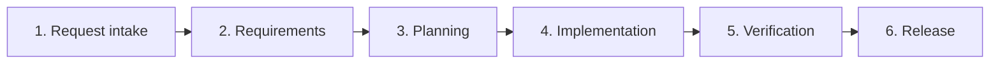

## End-to-End

### Workflow

### Phases

| Phase | Definition | Actor responsible | Output artifact |
|---|---|---|---|
| 1. Request intake | Capture incoming requests (feature, change, or bug) verbatim, triage them against existing project records, collect obvious gaps as broad clarification questions, and group them. Once the requester confirms, create the request artifact. The only intake path; it is also the handoff. | `key-account-manager` | Requests (request artifact) |
| 2. Requirements | Elicit, document, and validate business and non-functional requirements traceable to the request and its open questions. Assess the impact on the domain model, glossary, and business rules; when needed, delegate domain modeling to `domain-modeler`, the glossary update to `terminologist`, and the business rules update to `business-analyst`. `bug` requests bypass this phase and go directly to planning. | `requirements-engineer` | Requirements; Domain Model, Business Glossary, Business Rules when impacted |
| 3. Planning | Evaluate which tasks must be performed to fulfill the requirement and attribute each task to the proper actor (for example `architect` for architecture analysis and `ui-designer` for mockups). Decide whether architecture impact analysis and UI design are needed. Involve the user to define the priority of the different requests and requirements. Update the roadmap and backlog accordingly: feature order, milestones, releases, tickets, dependencies, and ordinals. Each new or changed feature is packed into its own milestone, and each milestone gets one verification task for Phase 5. The result of planning is materialized in the backlog. Closes the request artifact once its work is planned or the remaining items are rejected. | `planner` | Backlog; Release (created and milestones assigned) |
| 4. Implementation | Process all tasks necessary for requirement fulfillment: code development, plus automated tests, architecture impact analysis and adaptation if required, and UI design and mockup creation. | `task-refiner`, `quality-gatekeeper`, `architect`, `tech-writer`, `ui-designer`, `planner`, `android-dev`, `backend-dev`, `frontend-dev`, `rust-dev` | Implementation plan, Architecture, Technical specification, UI Specification, UI Mockups, Source Code and Tests |
| 5. Verification | Independently verify a milestone at its boundary: its acceptance criteria, quality requirements, and code quality through the quality review and code audit; record the result in the milestone verification task. Determine the RC version of the verified milestone. Security is not assessed here. | `quality-gatekeeper`, Code Audit owner (TBD), `planner` | Audit (code audit); Milestone verification task |
| 6. Release | Inspect the whole release: resolve the scope, confirm every milestone is complete and verified, and run the release quality audit, the release-wide code audit, and the release security audit. The user approves the scope and the audit findings, then the final version is chosen from all included changes and the milestone RC versions, and the final build and tests run on that approved scope. Failures become fix tasks in a fix milestone that must finish before the release can complete. Assemble the release report from the verification evidence, request explicit release approval, and record release completion. | `quality-gatekeeper`, Code Audit owner (TBD), `security-officer`, `planner` | Audit (release quality, code, security); Release report; Release record completed with the final version |
