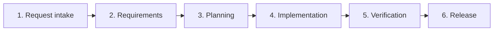

## End-to-End

### Workflow

### Phases

| Phase | Definition | Actor responsible | Output artifact |
|---|---|---|---|
| 1. Request intake | Capture incoming requests (feature, change, or bug) verbatim, triage them against existing project records, collect obvious gaps as broad clarification questions, and group them. Once the requester confirms, create the request artifact. The only intake path; it is also the handoff. | `key-account-manager` | Requests (request artifact) |
| 2. Requirements | Elicit, document, and validate business and non-functional requirements traceable to the request and its open questions. Assess the impact on the domain model, glossary, and business rules; when needed, delegate domain modeling to `domain-modeler`, the glossary update to `terminologist`, and the business rules update to `business-analyst`. `bug` requests bypass this phase and go directly to planning. | `requirements-engineer` | Requirements; Domain Model, Business Glossary, Business Rules when impacted |
| 3. Planning | Evaluate which tasks must be performed to fulfil the requirement and attribute each task to the proper actor (for example `architect` for architecture analysis and `ui-designer` for mockups). Decide whether architecture impact analysis and UI design are needed. Involve the user to define the priority of the different requests and requirements. Update the roadmap and backlog accordingly: feature order, milestones, releases, tickets, dependencies, and ordinals. The result of planning is materialised in the backlog. Closes the request artifact once its work is planned or the remaining items are rejected. | `planner` | Backlog |
| 4. Implementation | Process all tasks necessary for requirement fulfilment: code development, plus automated tests, architecture impact analysis and adaptation if required, and UI design and mockup creation. | `task-refiner`, `architect`, `tech-writer`, `ui-designer`, `android-dev`, `backend-dev`, `frontend-dev`, `rust-dev` | Implementation plan, Architecture, Technical specification, UI Specification, UI Mockups, Source Code and Tests |
| 5. Verification | Independently verify the acceptance criteria, quality requirements, and security posture through the quality review, code audit, and security audit, and record the evidence. | `quality-gatekeeper`, `security-officer`, Code Audit owner (TBD) | Quality Review Report, Security Audit, Code Audit |
| 6. Release | Assemble the release report from the verification evidence, request user approval, and record release completion. | `orchestrator` | Release report |
