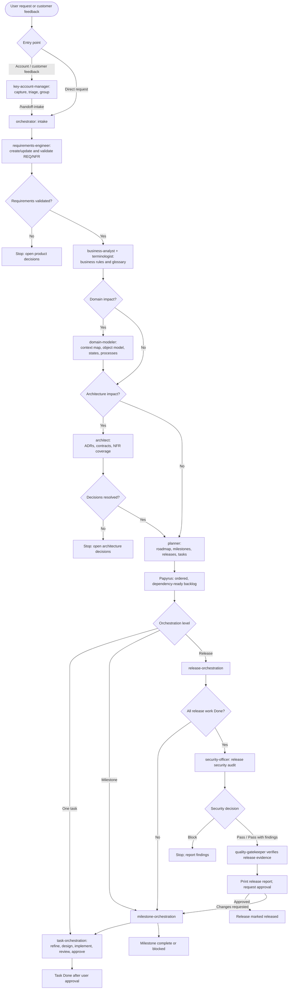
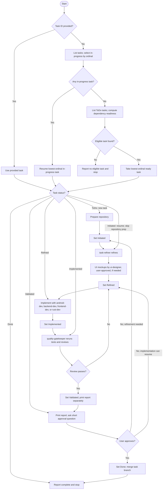
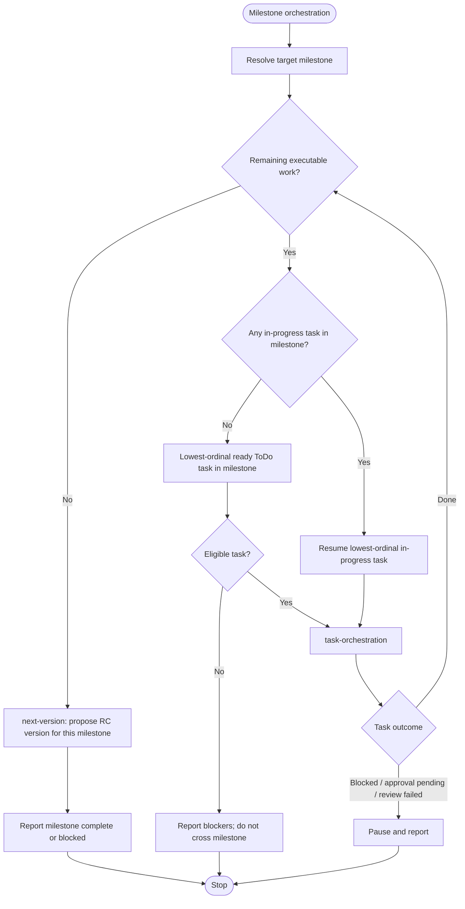
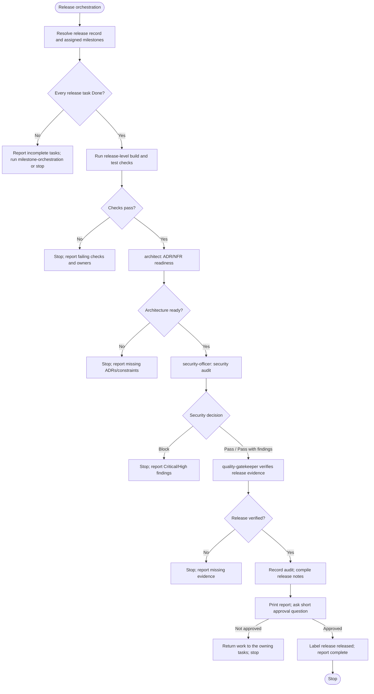

# Software Delivery Workflow

This document is the canonical description of how software is delivered in this project: from customer feedback and new requirements, through analysis, business rules, domain modeling, architecture, planning, design, implementation, and release.

The `orchestrator` is the entry point for direct requests and owns delivery execution. The `key-account-manager` is the customer-facing feedback entry point; it hands packages to the `orchestrator` and never to specialist agents directly. All backlog and managed-document reads and writes use the Papyrus CLI via the `papyrus` skill. Agent delegation uses OpenCode's `subagent` tool.

This document describes the **target** workflow. Agent and skill definitions must implement it; a mismatch between an agent or skill and this document is a defect to fix, not a license to deviate.

## Ownership

| Concern | Owner |
|---|---|
| Customer feedback capture, triage, grouping, handoff | `key-account-manager` (read-only; no files) |
| Requirement creation, update, validation, traceability | `requirements-engineer` (Papyrus `req`/`nfreq`) |
| Business analysis, business rules, gap detection | `business-analyst` (Papyrus `rule`) |
| Business glossary and terminology consistency | `terminologist` (Papyrus `glossary`) |
| Domain model artifacts (context map, object model, state diagrams, attribute lists, process diagrams) | `domain-modeler` |
| Architecture, boundaries, contracts, ADRs, NFR coverage | `architect` (Papyrus `decision`) |
| Roadmap, feature priority, milestone/task order, dependencies, releases | `planner` subagent, launched by `orchestrator` |
| Ticket refinement and feature specification | `task-refiner` |
| UI specifications and mockups | `ui-designer` (Papyrus `ui-spec`/`ui-mockup`) |
| Task, milestone, and release execution; status transitions; approval requests | `orchestrator` |
| Implementation | `android-dev`, `backend-dev`, `frontend-dev`, `rust-dev` |
| Quality review | `quality-gatekeeper` |
| End-of-release security audit | `security-officer` |
| Audit record and release completion record | `orchestrator` (Papyrus `audit`/`release`) |

The orchestrator is the primary entry point. It executes the plan and delegates planning or plan changes to the `planner` subagent; it does not plan itself. It is read-only with respect to project source and documentation content: it never edits source, docs, requirements, or managed records directly. Its only writes are Papyrus status/metadata operations, evidence comments, audit records, release completion records, and git operations limited to branch creation/switching, staging, commit, merge, rebase, and pull (no push, stash, reset, clean, or discard).

## Entry points

1. **Direct request** — the user asks `orchestrator` for a new feature, a requirement change, a plan change, or execution. The orchestrator captures it and starts the workflow.
2. **Customer feedback** — the user works with `key-account-manager`, which captures statements verbatim and triages them in-session. On explicit order, KAM shows the handoff package, the user confirms, and the user runs `/handoff-intake`. That command switches the current session to `orchestrator` with the package in context. The orchestrator treats the package as the captured request.

KAM is read-only and retains nothing after a handoff. It hands off only through `/handoff-intake`; it never delegates to `requirements-engineer`, `planner`, or a development agent.

## End-to-end flow

Rules:

- Phases 2-5 (requirements, rules, domain, architecture) run before planning. Each has a stop gate; do not plan against unvalidated or unresolved input.
- Domain and architecture phases are conditional, but the condition must be decided explicitly, not skipped silently.
- A new feature or requirement is never sent directly to `planner`; requirements come first.
- Implementation starts only after requirements are validated, the plan is checked, and any affected UI mockup is approved.
- If a change affects an in-progress task, pause and ask the user before reordering or re-scoping it.
- Open product, business, or architecture decisions stop the flow; never guess.

## Phase 1 — Feedback intake

Applies when the user provides customer or account feedback.

- `key-account-manager` captures statements verbatim, triages them with evidence, groups them by theme, and confirms the triage with the user.
- Feedback exists only in the session. No feedback files, registries, or indexes are created.
- The handoff is manual: it happens only on an explicit order, after the user sees the package.
- The handoff is the `/handoff-intake` session switch. Handed-over items are forgotten by KAM and are not re-offered.
- The package carries: grouped items, verbatim quotes, affected areas, severity, existing evidence, and open questions.

Details: `key-account-management` skill and `.opencode/agents/key-account-manager.md`.

## Phase 2 — Requirement analysis

Applies to every new feature, new requirement, or requirement change, including KAM handoffs.

1. **Capture** — `orchestrator` records the requested behavior, source, and affected scope. When a KAM package is present, it is the captured request; never ask the user to repeat it.
2. **Requirements** — delegate to `requirements-engineer`. It identifies affected REQ/NFR groups, asks the user for missing precision or product decisions, creates or updates records through Papyrus, and validates traceability and consistency.
3. **Validate** — require created/changed REQ/NFR IDs, validation status, open product questions, Papyrus visibility confirmation, and whether NFRs or new integrations are touched.
4. **Stop on gaps** — unresolved product decisions are blockers. Do not continue to business rules, domain modeling, architecture, or planning.

`requirements-engineer` is the sole editor of business requirements; architects may maintain non-functional requirements but route business-requirement changes back to it.

## Phase 3 — Business rules and glossary

Runs after requirements are validated.

- `business-analyst` analyzes business needs, clarifies and validates business rules (`RUL`), and performs gap detection against the requirements.
- `terminologist` maintains canonical business terminology (`GLO`) and checks wording consistency across docs and backlog.
- New or changed domain language is entered in the glossary before it is used in specifications, tickets, or UI text.
- If a rule or terminology gap changes the intended behavior, return to Phase 2; do not patch requirements by implication.
- Open business decisions stop the flow.

## Phase 4 — Domain modeling

Runs when the feature changes domain concepts, lifecycle states, attributes, or business processes.

- `domain-modeler` maintains the context map, business object model, state diagrams, attribute lists, and business process diagrams under `docs/domain-model/` and `docs/business-processes/`.
- Artifacts must reflect the validated requirements and business rules; conflicts are reported back to the owning phase instead of guessed.
- Plain domain documentation is Markdown owned by `domain-modeler`; Papyrus-managed records stay with their owners.

## Phase 5 — Architecture

Runs when the intake touches NFRs or introduces new integrations, cross-cutting scope, a new module, or a new stack.

- `architect` defines boundaries, contracts, and technical decisions, records ADRs (`ADR`) and business decisions (`BDR`) through Papyrus, and verifies NFR coverage.
- Architecture decisions must be resolved and accepted before planning; unresolved ADRs stop the flow.
- Architecture may update non-functional requirements; business-requirement changes go back to `requirements-engineer`.

## Phase 6 — Planning

`planner` owns the roadmap, feature priority, and milestone/task order. `orchestrator` invokes it after requirements and any required business, domain, and architecture work are settled.

The planner:

- maintains the `Feature Roadmap` technical specification (`TECH`) with ordered features, source REQ/NFR IDs, and rationale;
- groups the roadmap into milestones that each deliver a usable increment;
- creates the `Release <version>` records and assigns milestones with `papyrus milestone edit <MS-ID> --release <REL-ID>`;
- creates high-level feature tickets traceable to requirement IDs;
- encodes execution order with `ordinal` (lower first) and `dependencies`;
- validates the dependency DAG, requirement coverage, and milestone/release placement.

Papyrus has no priority field. User priority is encoded through `ordinal` and `dependencies`; the planner never invents priority.

For a new project, the planner schedules bootstrap work before feature tickets: domain modeling (context map and business object model, delegated to `domain-modeler`) and technical-stack definition (delegated to `architect`).

After a requirement change, the planner checks roadmap coverage, milestone placement, dependencies, and task order, then reports the corrections or explicitly reports `no change needed`.

If execution reveals a plan defect (missing dependency, wrong order, missing milestone scope, priority conflict), the orchestrator pauses and delegates a plan repair to `planner`.

## Phase 7 — UI design

UI design runs per ticket during refinement, before implementation.

- `task-refiner` authors the feature specification and identifies the UI impact.
- `ui-designer` produces UI description documents (`UI`) and one self-contained HTML mockup (`MOCK`) per affected ticket, covering the current feature's happy path. Layout only; no technology or library details.
- Every referenced `MOCK` record must be explicitly approved by the user (`approved` in Papyrus) before the task can enter `Refined` and before implementation starts.
- Materially revised mockups require approval again.
- If the design exposes a requirements gap, return to Phase 2; do not implement around it.

## Phase 8 — Execution

The orchestrator loads the matching skill and drives work to completion. It never edits project files; it records status, evidence, and approvals through Papyrus and performs the allowed git operations.

### Task selection and resume

- If a task ID is supplied, orchestrate that task.
- Otherwise, read all tasks with `papyrus --json task list` and resume the lowest-ordinal task whose status is `Initiated`, `Refined`, `Implemented`, or `Validated`.
- If no task is in progress, read `papyrus --json task list --status ToDo`, build the set of `Done` task IDs with `papyrus --json task list --status Done`, and take the lowest-ordinal ready task whose dependencies are all `Done`. Do not reorder the list or ask the user to pick among candidates.
- On resume, read the selected task status and skip completed phases. **Repository preparation is only for a new `ToDo` task; never run it when resuming `Initiated` or later.**
- Papyrus has no `--ready`, `--sort priority`, or `--plain` flags.

### Task steps

1. **Resolve task.** Follow the selection rules above. `papyrus task` is the CLI command for task operations; it does not launch agents.
2. **Prepare repository (new tasks only).** For `ToDo`, inspect the working tree and prepare the task branch using git (status, checkout `main`, pull, create `task/<task-id>` if it does not already exist). Reuse an existing branch and preserve existing changes rather than recreating them. Never commit, stash, discard, or otherwise alter uncommitted changes without explicit user approval. If git operations are denied or fail, stop and ask the user to prepare the branch and working tree; never bypass the policy. For any resumed status (`Initiated` or later), skip repository preparation entirely and preserve the current branch and changes.
3. **Refine.** Delegate to `task-refiner`; set status to `Refined` when complete. Skip if already `Refined` or later. Run Phase 7 for affected UI and obtain explicit user approval for every referenced `MOCK` record before `Refined`.
4. **Implement.** Delegate units to `android-dev`, `backend-dev`, `frontend-dev`, or `rust-dev` according to the unit's goals. Record each agent's structured evidence as a Papyrus task comment; set status to `Implemented` when complete.
5. **Review.** Delegate to `quality-gatekeeper` using OpenCode's `subagent` tool. It independently reruns relevant tests, verifies the ticket, and returns a per-criterion evidence table. If incomplete, set status to `Refined`, address findings, and review again.
6. **Approve.** A passing review sets status to `Validated`. Print the gatekeeper report and the acceptance-criteria checklist separately, then ask a short approval question. Set status to `Done` only after explicit approval (or automatically in no-validation mode). If changes are requested, use `Initiated` if refinement is needed, otherwise `Refined` to resume implementation without repository preparation.
7. **Merge.** Once the task is `Done`, merge its branch into `main` with `--no-ff` (commit any uncommitted changes on `task/<task-id>` first; checkout `main`, pull, `git merge --no-ff task/<task-id>`; leave on `main`). Do not push.

### Milestone workflow

The orchestrator loads `milestone-orchestration`. A milestone is a coherent, usable delivery increment defined by `planner`.

Rules:

- Never take tasks from another milestone.
- A milestone is complete when it has no remaining `ToDo` or in-progress tasks. Milestones have no status; completion is derived from their tasks.
- A milestone may be assigned to a release (`metadata.release`); release auditing and closure still belong to `release-orchestration`.
- If incomplete tasks remain but none is dependency-ready, report blockers and stop.
- Pause for every user approval gate; milestone execution does not bypass task approval, unless the user explicitly requested no-validation mode.
- Before declaring a milestone complete, delegate a lightweight architecture-consistency check to `@architect` (contracts, layering, NFR coverage, ADR status); pause if an ADR is missing or not `Accepted`.
- Before packaging the milestone as an RC, run `next-version` in RC mode to propose the RC version from Done tasks; record it in the milestone report. Do not create tags or modify version files.
- Re-read milestone state after each task.

## Phase 9 — Release

The orchestrator loads `release-orchestration`.

**Release definition:** a release is a Papyrus `REL` record titled `Release <version>` (for example `Release 1.0`). Its description carries the release acceptance criteria, and milestones are assigned with `papyrus milestone edit <MS-ID> --release <REL-ID>`. There is no release ticket. `planner` creates the record and assignments. If the project uses a different convention, the release scope must be stated explicitly by the user before orchestration starts.

Rules:

- A release cannot start until every task in its assigned milestones is `Done`.
- A release cannot complete while the security decision is `Block`.
- `Pass with findings` is allowed only when no unresolved Critical or High finding remains; Medium and Low findings are reported with owners and follow-up tickets.
- The release evidence is verified by `quality-gatekeeper` after the audit, with the audit report as evidence. If the release description has no acceptance criteria, state that explicitly and verify its definition of done directly.
- The orchestrator records the audit with `papyrus audit create --title "<REL-ID> security audit" --content "<report>" --audit-type security --reference <REL-ID>`.
- The release report includes: release scope, completed tasks, test/build results, security decision with severity counts, accepted risks, and open follow-ups.
- The orchestrator records completion with `papyrus release edit <REL-ID> --label released --description "<scope + completion note>"`.
- The orchestrator does not create Git tags unless the user explicitly asks and the environment allows it; it reports the recommended tag and command instead.

## Approval gates

- **Requirements and business rules:** open product or business decisions stop the flow; no approval substitutes for a resolved decision.
- **Architecture:** unresolved ADR decisions stop the flow.
- **UI mockups:** every referenced `MOCK` record must be `approved` in Papyrus before implementation.
- **Task:** `Done` requires explicit user approval after a passing quality review.
- **Milestone:** each task approval gate applies; milestone completion is reported, not auto-approved.
- **Release:** completion requires a passing security audit and explicit user approval.
- A passing review or audit is evidence, not approval.
- **No-validation mode:** when the user explicitly asks to implement a whole milestone without validation/approval, task approval gates are bypassed (a passing review sets `Done` automatically) and execution continues; requirements, business rules, architecture, refinement, UI mockup approval, security audit, and stop conditions still apply.
- **Task completion merge:** when a task reaches `Done`, merge its branch into `main` with `--no-ff` (commit pending changes first) and leave the repository on `main`. No push is performed.

## Stop conditions

Always stop and report when:

- requirements, business rules, or architecture decisions are unresolved;
- no eligible task exists;
- the milestone is empty or blocked;
- a task is blocked on user input or approval;
- quality review fails without a clear fix;
- the security audit returns `Block`;
- a dependency cycle or cross-milestone ordering defect is found;
- the user interrupts or withholds approval.

## Resume and interruption

- Task state lives in the Papyrus task status and the repository branch.
- Milestone state is derived from its tasks; no separate milestone state is stored.
- Release state is derived from the release record, its assigned milestones, their tasks, and the latest audit record.
- Re-invoking any orchestration skill reads current state first and resumes from the matching step. Do not recreate branches, discard changes, or restart completed phases.
- Each step is idempotent: check the current status before acting.
- Interrupted requirement work is re-validated on the affected requirement group before continuing.

## Documentation and indexes

- `papyrus browser` is the documentation index for tasks, milestones, releases, requirements, NFRs, rules, glossary terms, decisions, specifications, mockups, and audits.
- `papyrus search "<query>"` searches the corpus.
- Never generate or hand-edit `index.html`; index generator scripts are not used.
- Plain documentation (architecture narratives, domain-model diagrams, business-process diagrams) remains Markdown owned by its agents.

## Papyrus and delegation

- All backlog and managed-document reads and writes use the Papyrus CLI via the `papyrus` skill.
- Subagent launches use OpenCode's `subagent` tool, not the Papyrus CLI's `task` command.
- The orchestrator never edits `backlog/` files, managed document files, or project source/docs directly.
- Plan changes (scope, priority, milestone order, dependencies) are routed to `planner`; ticket scope changes are routed to `task-refiner`.
- New features and new or changed requirements are routed to `requirements-engineer` first; `planner` is called only after requirements are validated and the applicable business, domain, and architecture phases are settled.
- Feedback packages are routed by `key-account-manager` to `orchestrator` only, through `/handoff-intake`.
- Papyrus has no priority field and no `--ready` flag. Use `ordinal`, `dependencies`, and JSON state reads.

## Conformance

- Every phase above has an owning agent. If no agent owns a phase, the workflow is incomplete.
- Agent and skill instructions must not contradict this document. Fix the agent or skill instead of documenting a workaround.
- Changes to phase order, ownership, or gates require updating this document first.

## References

- [key-account-management skill](../../skills/key-account-management/SKILL.md)
- [task-orchestration skill](../../skills/task-orchestration/SKILL.md)
- [milestone-orchestration skill](../../skills/milestone-orchestration/SKILL.md)
- [release-orchestration skill](../../skills/release-orchestration/SKILL.md)
- [security-audit skill](../../skills/security-audit/SKILL.md)
- [next-version skill](../../skills/next-version/SKILL.md)
- [papyrus skill](../../skills/papyrus/SKILL.md)
